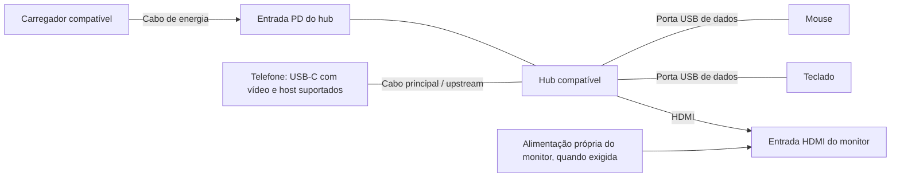

Esta aula começa quando **um Linux nativo compatível já está instalado e inicia no telefone**. O objetivo é conseguir trabalhar nele: entrar na conta, reconhecer o sistema, criar um documento, executar um programa e verificar monitor, teclado, mouse, rede e energia. Ao terminar, você terá um registro do que funciona na sua montagem, incluindo o comportamento depois de desconectar o hub.

Não é uma receita de instalação para qualquer smartphone. Se você ainda está no Android, numa janela Termux ou num Debian iniciado pelo PRoot, comece por [escolher o caminho](../escolha/index.mdx). Para a instalação do sistema, use [Linux nativo](../nativo/visao-geral.md) e a documentação do **modelo e variante exatos**. Ter a interface GNOME visível não prova, sozinho, que ela seja a sessão principal do aparelho.

**Dificuldade:** iniciante para o uso diário; os defeitos de drivers encontrados nos testes podem exigir trabalho avançado. **Tempo:** reserve uma sessão sem pressa e pare em cada ponto de conferência. **Resultado esperado:** um mini-PC utilizável nos recursos realmente suportados pelo port; recursos ausentes serão registrados, não tratados como compatíveis por suposição.

:::info O que foi verificado
O roteiro e as fontes foram revisados documentalmente em **11/10/2026**. Os comandos desta aula não foram executados num telefone durante essa revisão. As saídas de exemplo são ilustrativas. Resultados do [OnePlus 9 Pro deste projeto](../dispositivos/oneplus-9-pro.md) não certificam outro aparelho, kernel, hub ou carregador.
:::

## 1. Separe os materiais e identifique a sua situação

Coloque o telefone numa superfície ventilada e tenha disponíveis:

| Material | Para que serve | O que conferir antes |
|---|---|---|
| Telefone com instalação nativa confirmada | Executará o sistema e os aplicativos | Modelo, variante, imagem, kernel e instruções do port |
| Forma de controlar a sessão | Evita ficar sem acesso | Tela/touch utilizáveis ou vídeo/periféricos já suportados |
| Conta criada durante a instalação | Guarda arquivos e configurações | Nome da conta e senha, sem publicá-los |
| Rede conhecida | Downloads e acesso de manutenção | Dados de acesso e autorização para usar a rede |
| Notebook opcional | SSH, backup e leitura da documentação | Cliente SSH e endereço atual do telefone |
| Monitor e cabo adequados, se necessários | Tela maior | Entrada correta, alimentação e suporte de vídeo do telefone |
| Hub e mouse/teclado, se necessários | Conecta periféricos | Manual do hub, porta principal, entradas de dados e PD |
| Carregador e cabo compatíveis | Mantém a bateria | Requisitos do telefone/hub e potência realmente negociável |

USB-C é o formato do conector; ele não garante saída de vídeo. Uma porta do hub descrita apenas como **Data / 5 Gbit/s** não deve ser usada como se fosse saída USB-C de monitor. Verifique o manual e [entenda USB-C, hubs e energia](../hardware/usb-c-hubs.md) antes de comprar ou rearranjar cabos. Se o telefone não tem vídeo externo suportado, use a tela local ou [acesso remoto](../desktop/acesso-remoto.md); um hub HDMI comum não cria essa capacidade.

Antes da aula, salve arquivos importantes e preserve a documentação de recuperação do port. Um telefone com bateria muito baixa deve ser carregado pela montagem conhecida, antes de testar desconexões. Bateria estufada ou aparelho com dano elétrico exige avaliação física; otimização de software não corrige isso.

Nesta aula, cada ação tem um lugar:

- **No telefone:** terminal do Linux nativo ou uma conexão SSH que entrou nele.
- **No notebook:** programas do computador usados para acesso e backup.
- **Ação física:** observar a tela, selecionar a entrada do monitor e trocar uma conexão.

O terminal SSH aparece no notebook, mas os comandos executados depois do login pertencem ao telefone. Não instale GNOME no notebook pensando que isso vai modificar o celular.

**Conferência A:** você sabe qual imagem instalou, qual conta utilizará e como controlará o aparelho. Se falta uma dessas informações, consulte [inventário](../compatibilidade/inventario.md) ou [erros para iniciantes](../diagnostico/erros-para-iniciantes.md) antes de mudar serviços.

## 2. Entre na conta e reconheça o sistema

Se aparece uma tela de login, escolha a conta criada na instalação e digite sua senha. Se o port configurou login automático, você pode entrar diretamente na área de trabalho. Não existe uma senha Linux universal nesta documentação; PIN antigo do Android, senha do Wi-Fi e senha da conta Linux são coisas diferentes.

Se só existe acesso remoto, faça primeiro [a aula de SSH](../projetos/ssh-remoto.md), desde a instalação do cliente no Windows, macOS ou Linux. O hub costuma ocupar a única porta do telefone: prepare SSH por uma rede validada antes de depender dessa porta para manutenção.

Na sessão gráfica, abra **Atividades**, procure **Terminal** ou **Console** e abra o aplicativo disponível. Se nenhum estiver instalado, use o terminal de manutenção previsto pelo port; [instalar aplicativos](../desktop/instalar-aplicativos.md) explica como localizar os pacotes. Não abra `adb shell` como substituto automático: ADB depende de um serviço específico e pode não existir no Linux nativo.

Digite uma linha de cada vez, pressionando Enter ao final:

```sh
cat /etc/os-release
uname -m
uname -r
cat /proc/1/comm
id
```

| Comando | O que observar | O que ele não comprova |
|---|---|---|
| `cat /etc/os-release` | Nome e versão do espaço de usuário Linux | Se esse espaço está em PRoot/chroot ou inicia nativamente |
| `uname -m` | Arquitetura; muitos aparelhos mostram `aarch64` | Que qualquer binário ARM64 funcionará com a biblioteca C instalada |
| `uname -r` | Versão do kernel em execução | Que o kernel seja igual ao de outro port com o mesmo número |
| `cat /proc/1/comm` | Nome do processo inicial, PID 1 | `init` sozinho não identifica todas as integrações OpenRC ou customizadas |
| `id` | Conta atual, UID e grupos | Que essa conta tenha autorização sudo/doas |

Exemplo **fictício**, para aprender a ler, não para copiar como resultado:

```text
NAME="postmarketOS"
aarch64
6.x.y-port-exemplo
systemd
uid=1000(aluno) gid=1000(aluno) groups=1000(aluno),...
```

Anote seus valores reais. Se PID 1 é `systemd`, a administração normalmente segue essa integração. Se `rc-status` existe e a documentação confirma OpenRC, siga OpenRC. Um nome diferente ou um `init` customizado exige ler a receita do port. Não troque o init para conseguir executar um comando de outro tutorial.

Para saber se **a sessão visível** é GNOME, execute no terminal aberto dentro dela:

```sh
printf 'desktop=%s\ntipo=%s\n' "$XDG_CURRENT_DESKTOP" "$XDG_SESSION_TYPE"
```

`GNOME` e `wayland`, por exemplo, descrevem o contexto desse terminal. Essas variáveis vazias num SSH não provam defeito. Para distinguir GNOME principal de uma sessão aninhada, siga [GNOME nativo](../desktop/gnome-nativo.md), que verifica processos, display manager e serviços. Não remova XFCE nem encerre o único desktop antes dessa verificação.

**Conferência B:** registre distribuição, versão, arquitetura, kernel, init confirmado e conta. A confirmação da instalação nativa vem também da receita e do boot utilizados, não apenas das cinco linhas acima.

## 3. Confira a administração e, se necessário, crie outra conta

Para uso diário, utilize uma **conta comum**. Administração permite instalar pacotes ou mudar o sistema; não é necessário trabalhar o tempo inteiro como `root`. Abra **Configurações → Sistema → Usuários**, ou o painel **Usuários** oferecido pela versão instalada, e confira a conta selecionada.

Se a instalação já criou sua conta e configurou administração conforme a documentação do port, continue com ela. Anote se as instruções usam `sudo`, `doas` ou uma conta administrativa separada. Instalar o comando `sudo` por si só não concede essa autorização.

Só crie uma conta adicional por este fluxo se **o painel Usuários está integrado, uma conta administrativa existente consegue desbloqueá-lo e a documentação da imagem permite essa gestão**:

1. Abra Usuários e clique em **Desbloquear**.
2. Digite a senha da conta administrativa solicitada na janela local.
3. Clique em **Adicionar usuário**.
4. Preencha nome e nome de usuário. Use um identificador simples, sem espaços, como uma conta pessoal escolhida por você.
5. Escolha **Administrador** apenas se essa pessoa deve administrar o sistema; caso contrário, escolha a conta padrão.
6. Defina a senha ou a opção de defini-la no primeiro login, conforme o painel.
7. Confirme que a conta aparece. Teste seu login antes de alterar a conta antiga.

Esse procedimento é documentado pelo [GNOME para adicionar contas](https://help.gnome.org/gnome-help/user-add.html), mas depende da integração administrativa da distribuição. Se Desbloquear falha, o painel não existe ou uma imagem customizada não oferece esse mecanismo, use o procedimento **específico do port**. Esta aula não fornece um `adduser` ou uma regra sudoers universal que pode produzir uma conta incompleta.

**Conferência C:** você consegue entrar numa conta comum e conhece o método administrativo válido. Sem isso, ainda é possível criar seus documentos; deixe instalações e alterações administrativas para depois de resolver o acesso documentado.

## 4. Faça as primeiras configurações pela interface

Pressione a tecla **Super/Windows** para abrir Atividades, ou clique na área de atividades indicada pelo seu GNOME. Digite **Configurações** e abra o aplicativo. Não precisa instalar temas ou extensões para realizar esta aula.

### Idioma, teclado e ponteiro

No painel de idioma/região, escolha português brasileiro se disponível. O idioma da interface e a disposição física do teclado são configurações diferentes. Em **Teclado → Fontes de entrada**, adicione o layout correspondente às teclas impressas: um teclado brasileiro com Ç geralmente pede a opção brasileira adequada; um teclado US exige seu layout correspondente. Use a prévia do layout antes de decidir. A [ajuda oficial do GNOME](https://help.gnome.org/gnome-help/keyboard-layouts.html) explica fontes e alternância.

Abra um campo de texto e escreva `teste 123`, uma letra maiúscula com Shift, pontuação e, se o teclado possui essas teclas, acentos e Ç. Clique antes no campo: apertar letras sem foco num aplicativo não é um teste válido. Se nenhuma tecla produz efeito, investigar layout ainda é cedo; vá ao [diagnóstico de entrada USB](../hardware/teclados-usb.md).

Em **Mouse e touchpad**, ajuste a velocidade gradualmente e confira cliques e rolagem. Aceleração do ponteiro altera o deslocamento; não corrige uma interface renderizada lentamente. Se precisar de entrada alternativa, procure **Acessibilidade → Digitação → Teclado na tela**, quando disponível.

### Wi-Fi e Bluetooth

Abra o menu superior e selecione Wi-Fi; escolha sua rede e forneça os dados solicitados. Rede de universidade/empresa pode exigir usuário, método de autenticação e certificado próprios: obtenha essa configuração do administrador. Não desative validação de certificado por tentativa. Abra um navegador instalado e carregue uma página pública para conferir acesso, além de observar o ícone de associação. A [ajuda do GNOME](https://help.gnome.org/gnome-help/net-wireless-connect.html) distingue conexão sem fio do acesso fornecido pela rede.

Para Bluetooth, abra o painel correspondente e consulte o manual do periférico para entrar em pareamento. Confirme o código quando solicitado. Um mouse/teclado que aparece como conectado precisa também movimentar o ponteiro ou digitar no campo. Use [Bluetooth e reconexão](../hardware/bluetooth.md) se o anúncio desaparece, o rádio não aparece ou o estado não corresponde ao uso.

**Conferência D:** os dispositivos de entrada já conectados respondem e a rede abre uma página. Se você usa somente touch/teclado na tela neste momento, registre isso; os periféricos físicos serão testados na etapa 7. Registre separadamente Wi-Fi, Bluetooth e USB: o sucesso de um deles não certifica os demais.

## 5. Crie o seu primeiro documento e uma pasta de trabalho

Abra **Atividades → Arquivos**. Escolha sua pasta pessoal na barra lateral, normalmente indicada como **Pasta pessoal** ou **Home**. É o espaço destinado aos seus arquivos; não escolha `/etc` ou `/usr` para guardar trabalhos. O [manual do GNOME Arquivos](https://help.gnome.org/gnome-help/files-browse.html) mostra a navegação e a barra de caminho.

No menu de contexto/menu do aplicativo, escolha **Nova pasta** e crie `mini-pc-aula`. Se esse nome já existe, abra a pasta e veja seus arquivos; não a substitua. Nomes iguais com maiúsculas diferentes podem representar pastas distintas no Linux.

Se um **Editor de texto** está instalado, abra-o em Atividades e crie um novo documento. Escreva:

```text
Meu primeiro dia com o mini-PC

Distribuição e versão:
Kernel:
Forma de acesso:
Monitor e hub utilizados:
O que funcionou:
O que ainda precisa de diagnóstico:
```

Use **Salvar como**, navegue à pasta pessoal → `mini-pc-aula` e salve como `primeiro-dia.txt`. Feche apenas o documento depois de salvar e abra-o novamente pelo aplicativo Arquivos. Ver o texto de volta é a evidência de que ele foi gravado; uma janela aberta ainda não basta.

### Alternativa concreta pelo terminal: nano

Se não existe editor gráfico, verifique no terminal do telefone `command -v nano`. Se não há resposta, instale **somente o pacote necessário e somente na distribuição identificada**, por um administrador já configurado:

```sh
# Debian/Ubuntu nativo, com sudo já autorizado
sudo apt update
sudo apt install nano
```

```sh
# Alpine/postmarketOS nativo, com doas já autorizado
doas apk update
doas apk add nano
```

Em uma imagem que documenta `sudo` em vez de `doas`, substitua apenas o prefixo administrativo do segundo bloco pelo método existente. Não execute os dois blocos e não adicione repositórios de outra release. [Instalar aplicativos](../desktop/instalar-aplicativos.md) explica busca, transação e erros.

Para abrir o mesmo arquivo, execute:

```sh
mkdir -p "$HOME/mini-pc-aula"
nano "$HOME/mini-pc-aula/primeiro-dia.txt"
```

`mkdir -p` cria a pasta se falta e preserva uma pasta já existente. O nano abre o arquivo indicado; se ele já tem conteúdo, não cole um novo texto por cima sem revisá-lo. Digite suas notas. Para gravar, segure Ctrl e pressione **O**, solte e pressione Enter para confirmar o nome mostrado. Para sair, **Ctrl+X**. Em seguida, leia:

```sh
cat "$HOME/mini-pc-aula/primeiro-dia.txt"
```

O [manual do nano](https://www.nano-editor.org/dist/latest/nano.html) explica os atalhos: `^` na ajuda significa Ctrl. Se aparece erro ao escrever, não saia descartando o texto; confira pasta e permissões no [manual de erros](../diagnostico/erros-para-iniciantes.md).

**Conferência E:** existe um documento legível dentro da sua pasta pessoal e você consegue fechá-lo e reabri-lo.

## 6. Execute um primeiro programa no próprio telefone

Este exercício é opcional e não exige IDE, Arduino, root Android nem GPU. Ele demonstra que o Linux do telefone consegue executar um arquivo criado por você. Para um ambiente completo, continue em [programação desde zero](../projetos/desenvolvimento.md).

No terminal do telefone, confira `command -v python3` e `python3 --version`. Se ausente, escolha o bloco da sua distribuição, com o acesso administrativo já confirmado:

```sh
# Debian/Ubuntu nativo
sudo apt update
sudo apt install python3
```

```sh
# Alpine/postmarketOS nativo
doas apk update
doas apk add python3
```

Python é obtido pelos repositórios configurados da distribuição; não execute um instalador Windows `.exe` no telefone ARM64. Os catálogos [Debian](https://packages.debian.org/trixie/python3) e [Alpine](https://pkgs.alpinelinux.org/packages?name=python3) permitem conferir nome, versão e arquitetura. A versão da sua release pode diferir da versão da documentação online.

Este exercício usa **nano**, mesmo se o documento anterior foi criado num editor gráfico. Confira `command -v nano`; se não aparece um caminho, faça a instalação específica da etapa 5 antes de continuar. Entre na pasta e abra um arquivo novo:

```sh
cd "$HOME/mini-pc-aula"
pwd
ls
nano primeiro_programa.py
```

Se `primeiro_programa.py` já existe, escolha outro nome e utilize-o também na execução. No editor, escreva estas duas linhas, preservando aspas e parênteses:

```python
print("Meu mini-PC executou um programa Python!")
print("2 + 3 =", 2 + 3)
```

Salve com Ctrl+O, Enter e Ctrl+X. Agora execute no terminal:

```sh
python3 primeiro_programa.py
```

O resultado deve ser:

```text
Meu mini-PC executou um programa Python!
2 + 3 = 5
```

Python lê o arquivo e executa suas instruções; não é necessário marcar esse arquivo como executável para esse comando. Se aparece `SyntaxError`, confira a linha indicada: aspas curvas copiadas de um editor de texto formatado e parênteses faltando são causas possíveis. Se o erro é arquivo ausente, `pwd` e `ls` mostram onde você está. A [documentação Python](https://docs.python.org/3/tutorial/interpreter.html) explica a execução de scripts.

**Conferência F:** as duas linhas apareceram no terminal **do telefone**, não apenas num Python instalado no notebook. Isso testa o exercício básico; não comprova compatibilidade de bibliotecas, containers ou aceleração gráfica.

## 7. Monte monitor, hub e alimentação entendendo cada ligação

Antes de mexer nos cabos, salve o documento, suspenda downloads e ejete no aplicativo Arquivos qualquer unidade USB que será removida. Mantenha o acesso alternativo validado, se a tela do telefone está quebrada. Se apenas o cabo de manutenção permite controle e vídeo externo ainda não é suportado, não o retire para seguir esta aula.

Esta é **uma topologia possível**, somente para telefone/port com DisplayPort Alt Mode e hub conversor HDMI compatíveis. O sentido das setas indica a ligação e a função, não uma ordem universal de conexão:



1. **Leia as etiquetas.** Identifique o cabo principal que vai ao telefone, a entrada PD, a porta HDMI e as portas USB de dados do hub. Não deduza isso só pelo formato USB-C.
2. **Alimente o monitor conforme seu manual.** Um monitor portátil pode precisar de alimentação própria mesmo recebendo HDMI. A entrada USB-C de energia dele não recebe necessariamente vídeo nessa montagem.
3. **Ligue HDMI ao hub e à entrada HDMI do monitor.** No menu físico do monitor, selecione HDMI quando a escolha automática não for confiável. Observe se aparece o menu do próprio monitor: isso separa falta de energia da falta de sinal.
4. **Prepare a alimentação do hub apenas se a montagem a exige e os manuais a permitem.** Carregador/cabo precisam ser compatíveis. Uma porta USB-C do notebook não é automaticamente uma fonte PD suficiente para todos os dispositivos.
5. **Conecte o cabo principal ao telefone pela sequência recomendada pelo fabricante/port.** Aguarde o tempo de negociação e observe o aparelho, o monitor e os periféricos. Não existe uma sequência que resolva bugs de todos os controladores.
6. **Conecte teclado/mouse às portas de dados.** Observe luzes, mas confirme também digitação/movimento. Luz acesa prova alguma alimentação, não o funcionamento do driver.

Há outra possibilidade: telefone diretamente ligado a um monitor USB-C que aceita vídeo e energia na porta correta. Isso exige recursos e cabo apropriados em **ambas as pontas**, e pode deixar sem conexão física para outros periféricos. Não transporte essa possibilidade para uma porta USB-C **apenas de dados** do hub. Consulte [vídeo e hotplug](../hardware/video-hotplug.md).

### Ajuste a imagem e confira a carga

Com imagem visível, abra **Configurações → Telas**. Escolha somente resoluções e taxas oferecidas para aquele monitor, ajuste orientação/escala e use **Aplicar**. Confirme a configuração apenas se a imagem física está legível e completa; se ficar incorreta, aguarde a reversão do diálogo. O [GNOME documenta esse mecanismo de confirmação](https://help.gnome.org/gnome-help/display-dual-monitors.html.pt_BR).

O modo de espelhamento pode ficar limitado pela resolução comum entre telas. “Juntar telas” distribui janelas entre displays; uma janela pode estar na tela local quebrada. Não desligue o único display visível por tentativa. Registre a configuração que funciona antes de experimentar outra.

No painel Energia ou menu da bateria, observe estado e porcentagem. Anote porcentagem e horário, utilize uma carga de trabalho leve e confira novamente depois de 10–15 minutos. Perto de carga completa, limites de carregamento ou temperatura podem impedir aumento; perto de vazia, uma fonte insuficiente pode manter o ícone sem compensar consumo. O [guia de energia](../hardware/energia.md) explica leitura do driver e testes. Não conclua “carrega bem” apenas porque o hub ou o monitor acendeu.

**Conferência G:** imagem física completa, ponteiro e digitação respondem e a situação da bateria foi observada ao longo do tempo. Se só dois desses três pontos passam, documente separadamente o terceiro.

## 8. Confira som e um uso cotidiano

Abra **Configurações → Som**. Na seção Saída, selecione o dispositivo realmente utilizado: alto-falante do telefone, HDMI/DisplayPort, USB ou Bluetooth, quando oferecido. Comece com volume moderado, retire o mudo e use o botão de teste disponível. A [ajuda do GNOME](https://help.gnome.org/gnome-help/sound-usespeakers.html) orienta essa seleção.

Se escolheu HDMI, confira se o monitor possui alto-falantes ou saída de áudio utilizável; receber vídeo não significa produzir som. Para microfone, a seção é **Entrada**, não a fonte “Monitor de…” que captura áudio reproduzido. Veja [áudio por camadas](../hardware/audio.md) se nenhum dispositivo aparece.

Abra o navegador disponível pelo menu de aplicativos e carregue uma página pública. Não instale um binário para PC x86 num aparelho ARM. [Instalar aplicativos](../desktop/instalar-aplicativos.md) diferencia pacotes nativos, Flatpak, arquiteturas e limitações de sandbox. Teste uma página simples antes de usar uma videochamada/jogo: cada uso acrescenta exigências de codec, GPU, câmera e permissões.

Se deseja câmera, siga [câmeras e aplicações](../hardware/cameras.md). Um sensor com muitos megapixels no Android não implica uma câmera Linux pronta ou todos os modos expostos ao navegador. Esta aula não exige abrir uma câmera experimental para declarar o desktop básico utilizável.

**Conferência H:** o dispositivo de som escolhido produz o teste quando suportado e o navegador abre uma página. Registre uma função ausente como pendência, não como falha de todo o Linux.

## 9. Configure energia sem perder seu acesso

Em **Configurações → Energia**, escolha um tempo de apagar a tela adequado ao seu uso e registre o valor anterior. Espere o tempo escolhido; depois mova o mouse ou pressione uma tecla e confira se a sessão volta. Apagar a tela não é o mesmo que suspender o sistema. O [GNOME documenta o apagamento por inatividade](https://help.gnome.org/gnome-help/display-blank.html).

Use perfil **Balanceado**, se disponível, como ponto de partida. Máximo desempenho não deve significar desabilitar limites térmicos. Nem todo kernel de telefone fornece perfis ou sensores integrados ao GNOME.

Só experimente **suspensão automática** depois que o port documentar suporte a suspender/retomar e houver uma forma de recuperação física. A [opção do GNOME](https://help.gnome.org/gnome-help/power-autosuspend.html) não certifica os drivers do telefone. Suspensão também interrompe serviços de servidor e pode derrubar SSH; não a ative no único acesso de um dispositivo com tela inutilizável sem testar a retomada.

**Conferência I:** apagar/reativar a tela funciona sem encerrar os aplicativos. Suspensão será um teste separado, ou permanecerá explicitamente não validada.

## 10. Teste reinício e reconexão sem confundir os resultados

### Primeiro teste: iniciar sem o notebook

1. Salve todos os trabalhos e copie o documento para outro dispositivo, seguindo [backup](../preparacao/backup.md) ou SFTP na [aula SSH](../projetos/ssh-remoto.md).
2. Confira que sabe entrar novamente e recuperar o port. Não reinicie se a conta/rede de manutenção ainda dependem de comandos manuais desconhecidos.
3. Use **Reiniciar** no menu de energia da sessão. Não interrompa a alimentação durante a inicialização.
4. Observe login/GNOME e teste mouse/teclado. Com login manual configurado, entrar com senha é comportamento esperado; autologin é opcional.
5. Abra o documento salvo e execute novamente o programa. Aplicativos terem fechado no reboot é normal; arquivo desaparecido exige diagnóstico do armazenamento/persistência.

Se o desktop só surge depois de uma intervenção no notebook, a integração do boot ainda não está pronta. Volte a [GNOME principal](../desktop/gnome-nativo.md). Não configure remoção automática de outro desktop para esconder o problema.

### Segundo teste: hotplug de vídeo e periféricos

Hotplug significa conectar ou remover um dispositivo com o sistema ligado. Faça **um caso de cada vez**, com documentos salvos, bateria suficiente e sem armazenamento USB montado no hub. Não teste trocas de PD se essa montagem já provocou crash ou se o port as marca como instáveis.

| Caso | Ação física | Resultado esperado para um recurso suportado | O que anotar se falhar |
|---|---|---|---|
| HDMI | Retire e reconecte apenas HDMI, mantendo energia e hub | Imagem volta; sessão e aplicativos continuam | Menu do monitor, tempo, entrada selecionada, se SSH segue ativo |
| Teclado | Retire e reconecte apenas o teclado | Digitação volta num campo focado | Luz, USB detectado e eventos de entrada |
| Hub | Retire/reconecte o cabo principal, preservando as demais conexões | Vídeo e entrada voltam; aplicações permanecem | Quais funções voltaram, se houve logout/reboot/crash |
| PD, opcional | Somente conforme manuais e suporte do port; altere só a alimentação | Energia e funções permanecem ou recuperam conforme suporte declarado | Carga, desaparecimento de USB e perda de vídeo separados |

Durante os casos de vídeo, deixe um documento com uma palavra de teste aberta, sem conteúdo importante não salvo. Depois da reconexão, confira se **a mesma janela** continua. Um driver pode detectar o monitor e o compositor ainda encerrar a sessão; são problemas diferentes. Se o port não suporta sessão sem displays, esse limite precisa ser documentado e tratado na [sessão portátil](../desktop/sessao-portatil.md).

Quando há SSH, leia `cat /proc/sys/kernel/random/boot_id` antes e depois, guardando o resultado privadamente. Mudança sugere novo boot; igualdade permite dizer que não houve reboot naquele intervalo, mas não exclui reinício da sessão gráfica. CrashDump ou travamento exigem [triagem de recuperação](../recuperacao/triagem.md), não ciclos repetidos de reset de USB/vídeo.

**Conferência J:** um boot foi observado e cada caso de reconexão tem resultado próprio. Um teste que passou uma vez é uma evidência inicial; não garante todos os hubs, monitores ou carregadores.

## 11. Monte sua rotina de manutenção

Crie no seu documento um pequeno histórico: data, versão, montagem, alteração e resultado. Antes de mudar kernel, display manager ou firmware, preserve a receita que iniciou corretamente e um backup fora do telefone. Drivers e imagens precisam ser específicos do modelo; “atualizar tudo” não é um método de consertar incompatibilidade.

Para atualização comum, siga a política da **release e do port utilizados**. Verifique espaço no aplicativo Arquivos/armazenamento ou com `df -h`, tenha alimentação estável e leia o plano da transação. Não acrescente todos os repositórios disponíveis nem misture stable/edge para obter uma versão mais nova. O [guia de aplicativos](../desktop/instalar-aplicativos.md) explica esse processo; [segurança](../fundamentos/seguranca.md) explica contas, backups e exposição de serviços.

Para personalizar, comece pelos controles do GNOME: tema claro/escuro, papel de parede, fontes de entrada e escala. Adicione uma extensão compatível por vez, com possibilidade de desativá-la, depois de validar o desktop sem ela. Para usos seguintes, escolha [programação](../projetos/desenvolvimento.md), [Arduino/ESP32](../projetos/arduino-esp32.md), [servidor web](../projetos/servidor-web.md) ou [arquivos em rede](../projetos/arquivos-nas.md).

Guarde este resumo preenchido com **suas evidências reais**:

```text
Instalação nativa confirmada por:
Distribuição / versão / kernel / init:
Conta e forma administrativa: (sem senha)
Documento salvo e reaberto:
Programa Python executado no telefone:
Montagem de vídeo/periféricos/energia:
Rede / som / Bluetooth:
Boot sem comandos do notebook:
HDMI reconectado:
Teclado reconectado:
Hub reconectado:
Carga observada ao longo do tempo:
Pendências e referência de recuperação:
```

Este registro separa um recurso **não testado** de um recurso **testado e falho**. Se algum ponto ficou pendente, use o [manual operacional de erros](../diagnostico/erros-para-iniciantes.md) e envie à comunidade somente informações revisadas, sem senha, serial, endereço pessoal ou capturas de documentos privados.
