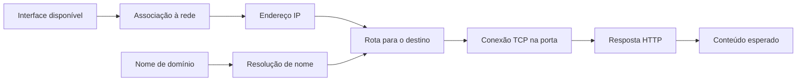

Seu telefone pode estar conectado ao Wi-Fi e, ainda assim, não abrir um site ou não aceitar a conexão do notebook. Isso não é uma contradição: associação ao ponto de acesso, endereço IP, rota, resolução de nomes e aplicação são etapas diferentes. Nesta aula você criará um servidor mínimo, começará pelo próprio aparelho e somente depois testará um cliente conhecido na sua rede. O resultado será uma explicação com evidências, em vez de uma sequência de resets.

**Dificuldade:** iniciante após [terminal](../comece-aqui/terminal-primeiros-passos.md) e [servidor Python](servidor-python.md). Materiais: telefone com Termux ou Linux operacional, Python 3.8 ou posterior, editor, `curl` quando disponível e um notebook para a etapa LAN opcional. Rede própria ou autorização explícita para esse laboratório. Não precisa de root Android, scanner de portas, conta de nuvem, alteração de firewall nem acesso administrativo ao roteador.

## 1. Defina quem é cliente, quem é servidor e o que quer provar

**Servidor** é o processo que espera conexões; nesta aula ficará no telefone. **Cliente** é o programa que inicia o pedido: primeiro um comando no próprio telefone, depois um navegador no notebook. **LAN** é a rede local, que pode incluir Wi-Fi e Ethernet. **Internet** é um conjunto de redes externas. Um servidor local pode funcionar sem internet; um navegador abrir um site externo não prova que dois clientes Wi-Fi conseguem conversar entre si.

Escreva numa folha ou na [ficha de evidências](../diagnostico/ficha-evidencias.mdx): “Quero que o notebook abra uma página fictícia servida por este telefone, nesta rede autorizada.” Anote data, ambiente, porta e local de cada comando. Isso impede investigar “a rede toda” sem um objetivo observável. Não inclua senha Wi-Fi, chave privada, token ou endereço público pessoal num relato aberto.

Nossa cadeia será:



Não existe uma obrigação de usar DNS quando o destino é um IP digitado diretamente. Não existe obrigação de ping responder para HTTP funcionar. E uma resposta HTTP não comprova que o site é o site esperado: você também verificará seu texto e o log do servidor.

## 2. Prepare ferramentas sem confundir Android e Linux

No **Termux externo**, já instalado conforme [o guia](../android/termux.md):

```bash
pkg update
pkg install python curl nano iproute2
python3 --version
curl --version
```

No **Debian/Ubuntu nativo**, com administração autorizada:

```bash
sudo apt update
sudo apt install python3 curl nano iproute2
```

No **Alpine/postmarketOS nativo**, com administração autorizada:

```bash
sudo apk update
sudo apk add python3 curl nano iproute2
```

O `iproute2` fornece ferramentas como `ip` e `ss`. Instalar o pacote no Termux não concede permissão para toda consulta do kernel. Android restringe a visualização de informações de rede por aplicativos, incluindo mudanças documentadas a partir do Android 10. Um “Permission denied” numa ferramenta de inspeção não significa automaticamente que um socket HTTP local não pode funcionar. [Mudanças de privacidade Android](https://developer.android.com/about/versions/10/privacy/changes#proc-net-filesystem).

No Debian PRoot, processos continuam sob o kernel e as políticas Android. Uma conta denominada root nesse ambiente não equivale a administrar as interfaces do telefone. Para esta aula, prefira Termux externo e mantenha uma camada a menos. Não instale um novo gerenciador de Wi-Fi dentro do PRoot para substituir as configurações Android. No Linux nativo, o port precisa fornecer driver, firmware e serviço de rede adequados; a aula não cria esse suporte ausente.

**Checkpoint 2:** você sabe onde Python executará e onde buscar o IP Wi-Fi. Ferramentas disponíveis não são evidência de associação ou de suporte físico do rádio.

## 3. Verifique associação e endereço atual

**Android com Termux:** abra as configurações Android, entre na rede Wi-Fi conectada e procure detalhes como endereço IP, gateway/roteador e máscara ou prefixo. Os nomes variam por fabricante e versão. Observe se existe aviso “conectado sem internet”; isso pode indicar uma LAN utilizável, uma rede sem acesso externo ou um portal pendente. Registre o endereço **atual**, não um número obtido num teste da semana passada.

**Linux nativo:** comece pelo indicador de rede e pelas configurações do ambiente. Se o sistema usa NetworkManager e já possui `nmcli`, `nmcli device status` é uma consulta possível. Não instale outro gestor só para essa linha. Consulte a [página de Wi-Fi](../hardware/wifi.md) para separar ausência de interface, firmware, associação, DHCP e autenticação empresarial.

Num Linux que permite consultas iproute2, execute:

```bash
ip -brief address
ip route show
```

`ip -brief address` resume interfaces e endereços; `ip route show` mostra rotas IPv4. Não use as variantes `add`, `delete`, `flush` ou `replace`: elas modificam configuração e não são necessárias aqui. Uma interface pode ter mais de um endereço, e o nome Wi-Fi pode ser diferente de `wlan0`. Não selecione `lo`, interface VPN ou rede USB apenas porque apareceu primeiro. [Manual de endereços iproute2](https://manpages.debian.org/trixie/iproute2/ip-address.8.en.html).

Você pode encontrar `127.0.0.1` em `lo`: é loopback, o próprio sistema. Endereços privados como os das faixas `10.x.x.x`, `172.16.x.x` a `172.31.x.x` e `192.168.x.x` são comuns em LANs, mas não identificam por si só a interface certa. Um endereço `169.254.x.x` merece investigar atribuição e contexto; não prova internet funcional nem deve ser automaticamente apagado.

O estado administrativo `UP` sozinho não demonstra que todos os requisitos de comunicação foram cumpridos. Também existe estado operacional, e interfaces diferentes podem reportá-lo de maneiras distintas. [Estados operacionais do kernel Linux](https://www.kernel.org/doc/Documentation/networking/operstates.txt). No Termux, se as consultas são bloqueadas, utilize a interface Android para obter o IP e avance ao teste da sua aplicação; não proponha desabilitar SELinux para imprimir uma lista.

**Checkpoint 3:** endereço associado à interface correta e contexto identificado. Se não há associação ou endereço apropriado, registre essa etapa como não confirmada. Não tente fazer um servidor público para compensar a ausência de rede local.

## 4. Entenda prefixo, gateway e rota sem alterar nada

Uma **interface** é um ponto de entrada/saída de rede do sistema. Um **endereço** identifica a comunicação naquele contexto. O **prefixo** participa da definição de quais destinos são considerados diretamente alcançáveis. O **gateway** é um próximo salto para destinos que precisam passar por outro equipamento. Uma **rota** escolhe por onde tentar chegar a determinado destino; sistemas com Wi-Fi, dados móveis, VPN e USB podem ter escolhas diferentes.

Um notebook e um telefone conectados ao mesmo nome Wi-Fi não têm necessariamente permissão de comunicação direta. O ponto de acesso pode isolar clientes; uma rede de convidados pode separá-los; a rede pode exigir autenticação individual. Mesmo a semelhança dos endereços não comprova ausência de isolamento. Não use estas observações como motivo para contornar políticas de campus ou empresa.

Num **cliente Linux nativo**, depois de identificar o endereço real do telefone, você pode consultar a decisão de rota com `ip route get` seguido desse endereço. Não cole um placeholder. Por exemplo, a forma abaixo apenas mostra a estrutura:

```text
ip route get ENDERECO_IPV4_REAL_DO_TELEFONE
```

A saída pode indicar interface e endereço de origem. Essa consulta não transmite um pedido HTTP e não prova que o próximo salto aceitou tráfego. Diferencie “há uma rota selecionada” de “o servidor respondeu”. Não adicione uma rota arbitrária nem troque IPs para fazer o exemplo visualmente coincidir. Se sua rede usa IPv6 exclusivamente, este percurso IPv4 não basta; documente a diferença e consulte orientação da rede em vez de inventar um IPv4. [Consulta e seleção de rotas no iproute2](https://manpages.debian.org/trixie/iproute2/ip-route.8.en.html).

## 5. Crie uma página dedicada e teste só loopback

**No telefone servidor:** confira se `aula-rede` já existe. Se sim, retome ou escolha outro nome. Para uma pasta nova:

```bash
mkdir "$HOME/aula-rede"
mkdir "$HOME/aula-rede/publico"
nano "$HOME/aula-rede/publico/index.html"
```

Cole no editor e grave:

```html
<!doctype html>
<html lang="pt-BR">
  <meta charset="utf-8">
  <title>Laboratório de rede do meu telefone</title>
  <h1>Laboratório de rede do meu telefone</h1>
  <p>Conteúdo fictício: resposta esperada na porta 8093.</p>
</html>
```

Inicie em primeiro plano:

```bash
python3 -m http.server 8093 --bind 127.0.0.1 --directory "$HOME/aula-rede/publico"
```

O terminal fica ocupado pelo servidor; abra uma segunda sessão do mesmo ambiente. `8093` é a porta alta escolhida para este exercício. Não use a pasta pessoal como `--directory`; todo conteúdo nela é candidato a acesso conforme o servidor e seus caminhos. O `http.server` é ferramenta de aprendizagem, **não servidor de produção**. [Documentação Python](https://docs.python.org/3.14/library/http.server.html).

Na segunda sessão:

```bash
curl --noproxy '*' --max-time 5 -i http://127.0.0.1:8093/
```

Espere `200` e o título do laboratório. `--noproxy '*'` evita desviar esse pedido por um proxy de ambiente; as aspas preservam o argumento. A resposta prova a comunicação local com a aplicação. Não usa Wi-Fi para ir a outro aparelho e não prova internet. No terminal servidor deve aparecer o pedido correspondente.

**Checkpoint 5:** conteúdo esperado, porta correta e registro concordam. Se aparece “address already in use” ao iniciar, outra aplicação já ocupa a porta; não encerre processos desconhecidos. Escolha outra porta alta e ajuste todas as consultas, ou encerre apenas uma instância sua identificada.

## 6. Compare socket TCP, HTTP e arquivo

Um **socket** é a interface de comunicação usada pelo programa. Nesta aula um endereço e uma porta recebem conexões TCP. HTTP é o protocolo de aplicação que vai nessa conexão e descreve pedido, status, cabeçalhos e conteúdo. Uma conexão TCP bem-sucedida não significa que qualquer arquivo solicitado exista.

Ainda na segunda sessão do telefone:

```bash
python3 -c 'import socket; con = socket.create_connection(("127.0.0.1", 8093), timeout=3); print("TCP conectado:", con.getpeername()); con.close()'
curl --noproxy '*' --max-time 5 -i http://127.0.0.1:8093/arquivo-ausente
```

A primeira linha testa uma conexão TCP sem solicitar documento. A segunda deve receber `404`: o servidor respondeu, mas não encontrou o arquivo pedido. O TCP pode aparecer no log como conexão sem pedido completo conforme o servidor; não espere que produza uma página. [API de sockets Python](https://docs.python.org/3.14/library/socket.html).

Num ambiente que permite inspeção, outra evidência é:

```bash
ss -ltn
```

Procure `127.0.0.1:8093`, sem exigir o nome do processo. `-l` seleciona escutas, `-t` TCP e `-n` números. O comando pode mostrar outros serviços; não mude nada neles. Se Android bloqueia a consulta, registre “inspeção indisponível” e use início do seu processo e consulta TCP/HTTP como evidências específicas. Lista de sockets vazia ou bloqueada não comprova sozinha que sua aplicação não escuta. [Manual mantido pelo iproute2](https://raw.githubusercontent.com/iproute2/iproute2/main/man/man8/ss.8).

Agora volte à primeira sessão e pressione Ctrl+C para parar **esse** servidor. Repita a consulta local. Ela deve falhar a conexão, enquanto a pasta e o HTML continuam existindo. Isso é um teste controlado de “servidor parado”; não atribua o resultado a DNS ou Wi-Fi. Inicie outra vez para retomar.

## 7. Faça a etapa LAN somente depois do sucesso local

Use rede própria ou autorizada. Identifique novamente o IPv4 Wi-Fi atual. Encerre o servidor loopback com Ctrl+C. Na mesma linha de início, substitua **somente** o argumento de `--bind` por esse IP real. A estrutura é:

```text
python3 -m http.server 8093 --bind ENDERECO_IPV4_REAL_DO_TELEFONE --directory "$HOME/aula-rede/publico"
```

Esse bloco é um modelo para edição, não uma linha pronta com endereço universal. Um IP inventado pode não pertencer ao telefone e gerar erro de bind. Evite trocar para todas as interfaces por comodidade; isso muda o alcance do laboratório. A escuta no Wi-Fi não autentica participantes da rede e não criptografa o conteúdo.

Primeiro faça uma consulta **do próprio telefone para esse IPv4** e confira o título. Depois, no navegador do notebook, escreva na barra o protocolo HTTP, esse endereço, dois-pontos, porta 8093 e `/`. Exemplo de formato: `http://IP_REAL:8093/`, substituindo `IP_REAL` pelo número observado. Não use `127.0.0.1` no notebook esperando chegar ao telefone. Não acesse HTTPS nesta etapa: nosso servidor não fala TLS.

O sucesso no cliente exige título correto **e** pedido registrado no servidor. Se local funciona e notebook falha, o problema está em uma etapa que a consulta local não exercitou: caminho entre aparelhos, isolamento, política, VPN/proxy ou cliente, entre outras possibilidades. Não reinstale Python antes de comparar essas evidências.

No fim, Ctrl+C no servidor, volte a `--bind 127.0.0.1` e confirme a consulta local. Não criamos encaminhamento de portas nem alteramos o roteador. O IP pode mudar após reconexão; registre o momento dos resultados. Um teste feito ontem não prova que o endereço de hoje é igual.

## 8. Use o notebook como cliente no sistema correto

### Windows

Abra **PowerShell**, não o terminal do telefone. `ipconfig` consulta a configuração de interfaces. Leia a seção correspondente ao Wi-Fi/Ethernet usado, não a primeira VPN encontrada. Não execute `/release`, `/renew` ou `/flushdns` como sequência automática: modificam o estado e não fazem parte desta consulta. [Manual Microsoft de ipconfig](https://learn.microsoft.com/en-us/windows-server/administration/windows-commands/ipconfig).

```powershell
ipconfig
$ServidorDaAula = Read-Host "IPv4 atual do seu telefone autorizado"
Test-NetConnection -ComputerName $ServidorDaAula -Port 8093
```

Informe somente o IP identificado; não use esse teste para buscar aparelhos desconhecidos. `TcpTestSucceeded` mostra o resultado do teste de conexão TCP. Um aviso de ping não equivale automaticamente ao fracasso desse campo. Depois faça o pedido HTTP no navegador para validar aplicação e conteúdo. [Test-NetConnection](https://learn.microsoft.com/en-us/powershell/module/nettcpip/test-netconnection?view=windowsserver2025-ps).

### macOS

Abra Ajustes do Sistema → Rede → a conexão em uso → Detalhes → TCP/IP para consultar o endereço, máscara/prefixo e roteador. Os rótulos dependem da versão. **Consulte sem alterar os campos.** A Apple documenta esse painel em [configurações TCP/IP](https://support.apple.com/en-gb/guide/mac-help/mh14129/mac). Use o navegador com o IP atual do telefone para o teste HTTP; não instale um servidor Nginx no Mac só para ser cliente.

### Linux

Consulte `ip -brief address` e, se preciso, `ip route get` para o IP real. Faça a consulta HTTP ao mesmo destino e porta no navegador ou com `curl`, usando limite de espera e sem proxy para a rede de estudo quando isso é apropriado. Não configure firewall do notebook nesta aula. Se uma regra administrada bloqueia o teste, documente e consulte quem administra o equipamento.

## 9. Teste nomes separadamente de IP e porta

**DNS** participa da resolução de nomes como `docs.python.org` para endereços. A resolução do sistema também pode considerar outros mecanismos e configurações locais. Um nome que resolve não garante que HTTPS complete, e uma página por IP na LAN não precisa de DNS. Para observar uma consulta de nome sem instalar outro utilitário, no ambiente Python:

```bash
python3 -c 'import socket; print(socket.getaddrinfo("docs.python.org", 443, type=socket.SOCK_STREAM))'
```

O resultado pode incluir IPv4 e IPv6. Essa linha consulta a resolução; **não abre a página HTTPS** e não comprova certificado ou disponibilidade do site. Se dá erro de resolução, anote o nome e o contexto. Não troque imediatamente o DNS do sistema: uma VPN, rede sem internet, portal ou política pode ser a origem. No Android, diferentes aplicativos podem ter políticas de rede distintas; no PRoot, sua configuração de resolução merece ser comparada com o Termux externo.

Para verificar acesso externo, use um site conhecido no navegador e observe a mensagem específica. Isso é outro teste, separado da página local. Não use um IP público fixo de terceiros como “teste obrigatório de internet”: a disponibilidade, a política e o protocolo desse destino podem mudar. A aula não precisa de internet depois das ferramentas instaladas para validar loopback.

## 10. Entenda o que ping pode e não pode concluir

`ping` usa mensagens ICMP no cenário comum, não o pedido HTTP da porta 8093. Alguns equipamentos, redes e sistemas permitem TCP e bloqueiam ICMP; outros respondem ICMP sem executar nosso servidor. No Android, o comando ou seu privilégio também pode ser restrito. **Ping ausente ou sem resposta é uma evidência limitada, não o veredito “telefone desligado”.**

Se `ping` já está disponível, você pode fazer poucos pedidos ao próprio loopback no Linux:

```bash
ping -c 3 127.0.0.1
```

Isso exercita loopback, não Wi-Fi. Para um IP de seu único dispositivo autorizado na LAN, substitua o destino conscientemente. No Windows, a contagem usa `-n`, não `-c`. Não rode laços por todos os endereços, scanner de portas ou testes contra equipamentos que não lhe pertencem. As consultas da aula usam um servidor que você acabou de iniciar e uma porta que definiu.

## 11. Transforme sintomas em conclusões proporcionais

| Evidência | O que permite afirmar | O que ainda não permite afirmar |
| --- | --- | --- |
| Wi-Fi associado na interface | Associação reportada naquele momento | Internet ou comunicação entre clientes funcionando. |
| IP Wi-Fi identificado | Endereço atribuído à interface | Rota e políticas até outro aparelho liberadas. |
| Rota consultada | Caminho escolhido pelo sistema | Destino alcançado ou serviço escutando. |
| TCP conecta | Conexão na porta chegou a um endpoint | Arquivo certo, autenticação ou HTTP saudável. |
| HTTP 404 | Aplicação respondeu sobre recurso ausente | Site inteiro quebrado ou falta de rede. |
| HTTP 200 e título correto | Conteúdo de estudo foi entregue | Segurança de produção ou permanência em segundo plano. |
| DNS resolve | Resolver retornou endereços | TCP/TLS/HTTP externos concluídos. |
| Ping falha | Esse teste ICMP não recebeu resposta esperada | Toda comunicação TCP impossível. |

“Connection refused” costuma indicar recusa em estabelecer a conexão naquele destino/porta; investigue início, bind e processo antes de considerar driver. “Timeout” permite várias hipóteses, incluindo caminho, política e destino: não identifica sozinho uma causa. “Name or service not known” pede investigar resolução do nome. Uma página de portal, proxy ou aplicativo diferente pede conferir conteúdo e identidade do servidor. Copie a mensagem curta relevante, escondendo dados pessoais.

## 12. Retome sem perder o acesso que já funciona

Ao terminar, pare somente seu servidor e preserve HTML e anotações. Na próxima sessão, confirme ambiente, endereço atual e objetivo antes de iniciar. Se estiver controlando o telefone exclusivamente por SSH/Wi-Fi, não desligue essa conexão para testar uma hipótese sem um caminho independente de retorno; consulte [SSH e arquivos](ssh-arquivos.md) e [recuperação](../recuperacao/triagem.md).

Faça um registro com: “loopback funcionou”; “bind no IPv4 Wi-Fi funcionou localmente”; “notebook recebeu ou não recebeu o título”; “request apareceu ou não no log”; “inspeção de sockets disponível ou bloqueada”. Esse conjunto reduz hipóteses sem afirmar compatibilidade inexistente. Na [biblioteca](biblioteca.mdx), o próximo passo pode ser [Nginx](nginx-servidor-local.md), um servidor de aplicação ou simplesmente manutenção do acesso remoto.

**Validação desta página:** fontes consultadas em 11/10/2026. O laboratório loopback de Python foi executado numa pasta temporária do notebook: conexão TCP, documento HTTP 200, arquivo ausente 404 e recusa após encerrar o processo. Não houve teste da LAN do leitor, Windows/macOS físico, Wi-Fi do telefone, inspeção Termux ou política de uma instituição. Esses resultados devem ser registrados no ambiente real; nenhum diagnóstico aqui exige varrer a rede ou modificar configurações globais.
