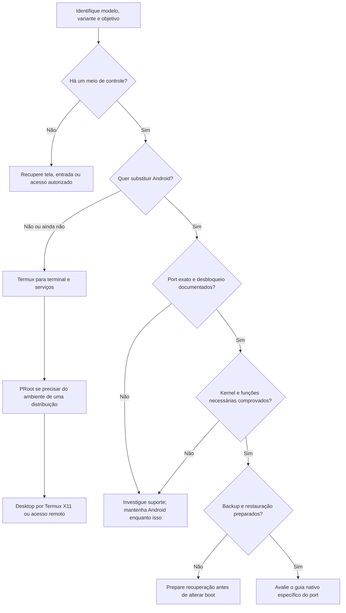

import PathAssistant from '@site/src/components/PathAssistant';

Antes de escolher uma distribuição, escolha o **resultado necessário**. Um terminal para programar, um servidor na rede local e um desktop com monitor exigem recursos diferentes. O melhor caminho é o que atende ao uso com funções comprovadas e um risco que você pode assumir.

## Assistente de decisão

Preencha somente o que você já verificou. “Sim” significa evidência para **este modelo, variante e versão**, não uma informação sobre outro celular com processador semelhante. As respostas permanecem na memória desta página e são perdidas ao recarregar. Não há consulta automática a um banco de aparelhos.

<PathAssistant />

## Árvore de decisão, sem formulário

O nó final não diz “execute flash”: diz **avalie o guia específico**. Mesmo um port existente pode exigir firmware base, uma variante ou uma versão de instalação diferente.

## Compare os caminhos

| Objetivo ou condição | Primeira opção a investigar | Limite que precisa entender |
|---|---|---|
| Programar e aprender shell com Android disponível | [Termux](../android/termux.md) | Pacotes são próprios do Android; programas Linux desktop não são todos intercambiáveis |
| Usar bibliotecas de uma distribuição sem root | [PRoot](../android/proot-distro.md) | Kernel Android, chamadas adaptadas, serviços e aceleração condicionados |
| Android com root já funcional e necessidade específica | [Chroot](../android/chroot.md) | Privilégio alto, mesmo kernel, não é uma VM nem substituição do Android |
| Substituir Android em modelo com port adequado | [Instalação nativa](../nativo/visao-geral.md) | Compatibilidade por recurso e versão; desbloqueio e recuperação necessários |
| Computador gráfico sem vídeo USB-C | [Acesso remoto](../desktop/acesso-remoto.md) | Depende de outro cliente para ver/controlar, mas programas podem executar no telefone |
| Tela quebrada sem ADB previamente autorizado | [Recuperar controle](../diagnostico/tela-quebrada.md) | Não há autorização ADB universal nem garantia de confirmação às cegas |
| Containers ou VM | [Containers](../projetos/containers.md) e [virtualização](../android/virtualizacao.md) | Recursos do kernel e arquitetura, não apenas RAM e root |

## Verificações que mudam a recomendação

**Modelo exato:** nome comercial pode incluir variantes incompatíveis. Registre código da etiqueta/configurações e codename confiável. **Arquitetura:** confirme sistema e CPU, não apenas a ficha de marketing. **Bootloader:** política de desbloqueio depende da variante, operadora e firmware. **Root:** é um privilégio no Android, não desbloqueio do bootloader.

**Suporte do port:** leia funções working/partial/broken, data e versão; “boots” não comprova desktop, vídeo ou bateria. **Kernel/drivers:** determine a combinação mantida, o firmware exigido e o que está integrado. **Saída de vídeo:** USB-C e velocidade de dados não provam DP Alt Mode. Um hub USB-C de dados não passa a fornecer vídeo USB-C só porque alimenta o monitor.

**Tela/touch/ADB:** um telefone acessível hoje pode perder esse canal depois de desbloquear e apagar dados. Faça o teste de recuperação sem depender do mesmo recurso que está quebrado. **Uso:** para um servidor sem tela, GPU e HDMI podem ser dispensáveis; para jogos de navegador, renderização por CPU pode ser uma limitação decisiva.

## Como escolher com incerteza

Se não encontrar evidências de port, não preencha “suporte documentado” por esperança. Comece pelo ambiente Android ou registre uma investigação de porting. É possível não haver um caminho viável para substituir Android neste aparelho. Essa resposta ainda permite um projeto útil, por exemplo um serviço simples no Termux.

Se a função essencial está parcial, defina um critério de aceitação. “Desktop conecta automaticamente por HDMI e conserva a sessão após reconexão” é testável. “Parece rápido” não é. Teste com seu hub, alimentação, cabo e versão; a [metodologia de diagnóstico](../diagnostico/metodo.md) ajuda a separar as camadas.

## Regras, fontes e verificação

O [contrato de decisão](criterios.md) explica exatamente quais condições o assistente utiliza e como são testadas. Revisão documental em **10/10/2026**, não inspeção automática de hardware. Fontes: [arquitetura AOSP](https://source.android.com/docs/core/architecture), [UBports e instalação em modelos suportados](https://docs.ubports.com/en/latest/userguide/install.html), [Termux](https://github.com/termux/termux-app) e os guias correspondentes. Nenhum nome digitado desbloqueia uma recomendação nativa por si só.
