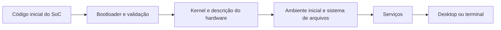

## O que acontece ao ligar

Antes de aparecer um desktop, o aparelho passa por estágios de inicialização. Código inicial no chip prepara recursos e carrega outros estágios. O **bootloader** seleciona e valida o que será iniciado. O kernel prepara memória e drivers; um ambiente inicial, quando usado, monta o sistema; o processo inicial inicia os serviços e a sessão.



Essa é uma visão conceitual. Nomes de imagens, formatos, ordem detalhada e validação variam por dispositivo. Linux em smartphone não deve ser tratado como a instalação de um ISO x86 em um notebook com firmware UEFI padrão.

## Bootloader bloqueado, root e depuração são diferentes

Um bootloader **bloqueado** restringe quais imagens aceita. O desbloqueio permite alterações conforme a política do fabricante e costuma apagar dados. Não basta que um comando exista no AOSP: fabricante, operadora, região e variante podem impedir ou exigir outra autorização.

**Root** é privilégio dentro de um sistema em execução. Pode permitir um chroot ou leitura de determinados arquivos, mas não comprova desbloqueio. **ADB** é uma ferramenta de depuração com autorização do Android; não é root automaticamente e não garante acesso no bootloader. **Recovery** é um ambiente separado de manutenção; suas funções dependem da implementação.

Você só precisa desbloquear para um caminho que realmente altere boot e o exija. Termux/PRoot não precisam disso. Veja [compatibilidade do bootloader](../compatibilidade/bootloader.md) antes de seguir um tutorial de instalação nativa.

## Partições não são pastas intercambiáveis

O armazenamento pode conter partições de boot, sistema, dados, firmware e metadados. Alguns aparelhos usam **slots A/B** para atualizações; outros usam partições dinâmicas dentro de uma estrutura maior. Um nome visto numa captura de outro dispositivo não prova que exista ou cumpra a mesma função no seu.

`boot`, `vendor_boot`, `init_boot`, `dtbo` e `vbmeta` são nomes encontrados em diferentes gerações Android, com condições específicas. Não escreva uma imagem só porque o arquivo tem esse nome. Versão do formato, tamanho, slot, firmware base e regras de verificação devem coincidir com o procedimento do port.

**Verified Boot** verifica componentes de inicialização. **Anti-rollback** pode impedir retornar a versões anteriores. Desativar uma verificação ou escolher um firmware antigo sem entender essa política pode transformar uma instalação recuperável em um problema mais grave. Não oferecemos comandos universais para apagar ou desativar essas estruturas.

## Device tree: descrever não é implementar

O **device tree** descreve o hardware para o kernel: endereços, interrupções, conexões, alimentação e dispositivos. Arquivos DTS/DTSI são fontes; DTB é uma forma compilada. Um driver pode depender dessa descrição para descobrir que um controlador existe e quais recursos usar.

Alterar um DTS não cria um driver ausente. Um nó USB incorreto pode deixar o controlador sem relógio ou alimentação; um nó de display incorreto pode impedir a imagem. Copiar a descrição de outro modelo com o mesmo SoC não é uma verificação de compatibilidade.

## Mainline, downstream e módulos

**Mainline** se refere ao desenvolvimento principal do Linux. Um kernel **downstream** inclui modificações mantidas fora dele, frequentemente do fabricante. Um downstream antigo pode ter suporte específico que um kernel recente ainda não oferece; um mainline recente pode ter correções e APIs que não existem no downstream. O número maior sozinho não decide qual serve ao aparelho.

Um **módulo** é um driver ou função compilado para carregar separadamente. Funções também podem estar embutidas no kernel. Por isso, ausência em `lsmod` não prova ausência de suporte. Módulos dependem da versão/configuração/ABI do kernel. Copiar um `.ko` de outra compilação pode falhar ou causar instabilidade.

No Linux já instalado, estas consultas ajudam a registrar a combinação:

```bash
uname -a
cat /proc/cmdline
lsmod
ls /lib/modules
```

`uname` identifica o kernel; `/proc/cmdline` mostra parâmetros se acessível; `lsmod` lista os carregados; `/lib/modules` mostra os diretórios instalados. Nenhuma linha autoriza substituir o kernel. A linha de comando pode conter identificadores: remova-os de relatos públicos.

## Como verificar suporte sem escrever nada

1. Identifique código de modelo, variante e firmware base.
2. Encontre a página do dispositivo no projeto e o pacote de integração correspondente.
3. Registre kernel e branch, configurações, patches, descrição do hardware e funções testadas.
4. Confirme que o guia explica formato de boot e instalação para a mesma combinação.
5. Localize recuperação documentada e seus requisitos antes de alterar qualquer partição.

Se faltar um item, a conclusão correta é “suporte não comprovado”. O [guia de porting](../nativo/porting.md) explica como investigar uma lacuna técnica; não converte a investigação em uma receita segura de flash.

## Fontes e verificação

Revisão documental: **10/10/2026**. Consulte [kernel no AOSP](https://source.android.com/docs/core/architecture/kernel), [Verified Boot](https://source.android.com/docs/security/features/verifiedboot), [partições dinâmicas](https://source.android.com/docs/core/ota/dynamic_partitions) e [uso do device tree no Linux](https://docs.kernel.org/devicetree/usage-model.html). Os conceitos não atestam o suporte do seu modelo.
