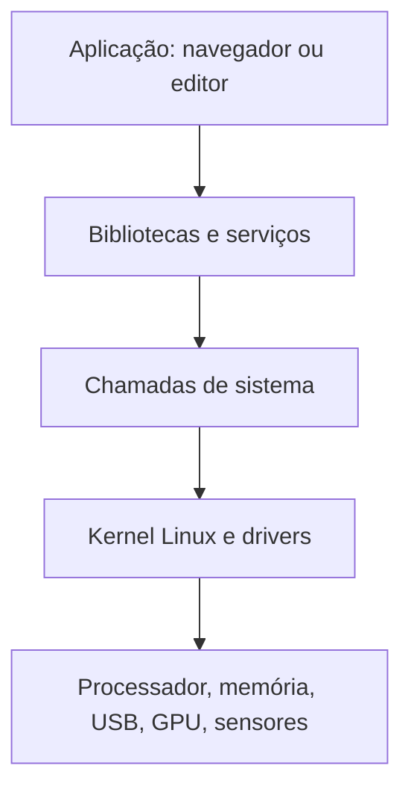

## Kernel não é o desktop

O **kernel** é o núcleo que organiza memória, processos e acesso aos dispositivos. Um programa pede recursos ao kernel por chamadas de sistema; ele não precisa controlar diretamente cada componente eletrônico. Android também usa um kernel Linux. Isso não significa que Android já ofereça o mesmo ambiente de programas de Debian ou Alpine.

Uma **distribuição** reúne kernel, bibliotecas, programas, gerenciador de pacotes e decisões de integração. O **espaço de usuário** é o conjunto que executa fora do kernel: terminal, navegador, serviços e desktop. Trocar esses programas sem trocar o kernel pode ser suficiente para programação e serviços, mas preserva limitações dos drivers e configurações do kernel atual.



Use essa separação ao investigar: instalar outra distribuição em PRoot não adiciona um driver USB ao kernel Android. Instalar GNOME não torna a câmera compatível com o navegador. Atualizar o navegador não resolve um controlador USB que perde seu papel de host.

## Por que o hardware funciona no Android e falha fora dele?

O fabricante integra kernel, firmware e serviços Android. A **HAL** — camada de abstração de hardware — fornece interfaces pelas quais o Android usa implementações específicas, por exemplo de câmera. Parte desse suporte pode estar em bibliotecas proprietárias, não num driver Linux padrão que um aplicativo desktop entenda.

Uma instalação nativa precisa de uma cadeia equivalente: driver no kernel, firmware adequado e interface reconhecida pelos programas. Uma câmera que entrega quadros por uma HAL Android não necessariamente aparece como dispositivo V4L2. Uma GPU com driver Android funcional não necessariamente oferece Mesa e Vulkan no Linux instalado.

**Firmware** é software executado dentro de um componente ou carregado para inicializá-lo. **Driver** é o código que permite ao kernel ou a outro subsistema operar o componente. Ter o arquivo de firmware não prova que o driver correto esteja presente; ter o driver não prova que o firmware ou as permissões estejam corretos.

## ARM64, aarch64 e compatibilidade de programas

Arquitetura é o conjunto de instruções e convenções que o programa espera da CPU. `aarch64` costuma identificar ARM de 64 bits no Linux; repositórios podem chamá-la de `arm64`. Um processador de 64 bits pode ter um sistema de usuário de 32 bits. Identifique ambos.

No terminal Linux do telefone, estas leituras não alteram o sistema:

```bash
uname -m
getconf LONG_BIT
cat /etc/os-release
```

`uname -m` informa a arquitetura apresentada pelo kernel; `getconf LONG_BIT`, quando disponível, ajuda a identificar o ambiente de usuário. `/etc/os-release` descreve a distribuição presente naquele ambiente. Em PRoot, esse arquivo pode dizer Debian enquanto `uname` continua identificando o kernel Android. Não há contradição: são camadas diferentes.

Além da CPU, programas dependem de bibliotecas e **ABI**, a interface binária entre componentes. Android usa Bionic; Debian geralmente usa glibc; Alpine usa musl. Um executável “Linux ARM64” pode depender de glibc e não iniciar diretamente no Alpine. Procure um pacote para a distribuição e arquitetura corretas, ou compile a partir do código-fonte com requisitos atendidos. Emulação não transforma drivers de outra arquitetura em drivers do aparelho.

## Quatro operações que parecem semelhantes

| Operação | O que muda | O que permanece |
|---|---|---|
| Instalar Termux | Aplicativo e ferramentas próprias | Android, kernel e política de aplicativos |
| Entrar em PRoot | Visão de caminhos e ambiente da distribuição | Kernel Android e privilégios reais do aplicativo |
| Entrar em chroot | Raiz do sistema de arquivos vista pelo processo | Kernel do sistema hospedeiro |
| Inicializar outro sistema | Kernel e/ou ambiente de boot, conforme o port | Restrições do bootloader e hardware físico |

**Container** acrescenta isolamento de recursos e processos quando o kernel oferece namespaces, cgroups e outras funções. **Máquina virtual** executa um sistema convidado com seu próprio kernel, usando virtualização ou emulação de hardware. Nem um diretório com Ubuntu nem um prompt com `root` provam que essas capacidades existem.

## Desktop, compositor e sessão

GNOME é um ambiente desktop. Na sessão Wayland, seu compositor organiza janelas, recebe entrada e apresenta a imagem. Ele depende de APIs gráficas e acesso autorizado ao display. Rodar GNOME em uma janela de outro desktop é uma sessão aninhada: útil para teste, mas diferente de inicializar diretamente nele.

X11 e Wayland são formas de organizar comunicação gráfica. VNC e RDP são formas de acessar sessões remotamente. Uma janela aberta pelo VNC pode mostrar programas executando no telefone; também pode mostrar um computador distante. Identifique o lado em que o programa executa antes de concluir que o telefone virou um desktop nativo.

## Quando esse conhecimento importa

Se seu objetivo é terminal e scripts, comece com poucas camadas. Para containers, examine o kernel. Para desktop nativo, examine compositor, drivers e boot. Para câmera e GPU, examine APIs e firmware. Para uma tela quebrada, estabeleça acesso e autorização antes de trocar o sistema.

Não há risco em ler identificadores básicos, mas logs podem incluir dados privados. Compartilhe versões e erros relevantes, ocultando senhas, endereços pessoais e identificadores desnecessários. Prossiga para [boot e kernel](boot-kernel.md) e [terminal e pacotes](terminal-pacotes.md).

## Fontes e verificação

Revisão documental em **10/10/2026**, sem certificação de modelos. [Arquitetura AOSP](https://source.android.com/docs/core/architecture) descreve as camadas Android; [documentação do kernel](https://www.kernel.org/doc/html/latest/admin-guide/README.html) introduz o Linux; [arquitetura Wayland](https://wayland.freedesktop.org/architecture.html) explica o compositor. Para detalhes de PRoot e virtualização, veja os respectivos tutoriais e fontes específicas.
