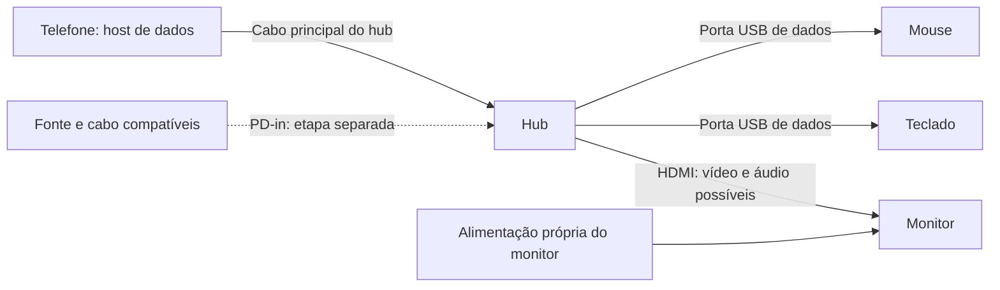

## O que significa uma montagem validada

Uma mesa com celular, hub e monitor ligados ainda não comprova um mini-PC confiável. Para isso, você precisa confirmar separadamente **imagem utilizável, entrada por teclado/mouse, alimentação suficiente e continuidade da sessão**. Esta aula ensina a montar, observar e registrar essas funções sem supor que USB-C garanta todas elas.

**Dificuldade:** iniciante na montagem; intermediária na leitura dos diagnósticos. **Resultado esperado:** uma combinação concreta de telefone, sistema, cabos, hub, fonte e monitor com testes documentados. Este procedimento foi revisado em **11/10/2026** por documentação; não foi realizado um teste físico do seu kit. “Validado” será o resultado da sua ficha, não uma promessa do título para qualquer aparelho.

Não há link de compra ou modelo obrigatório. Utilize os manuais dos equipamentos que possui. Se o telefone não oferece saída de vídeo suportada no sistema escolhido, a alternativa será acesso remoto ou Android com seu recurso de desktop documentado. Um hub com HDMI não acrescenta DisplayPort a um telefone que não o implementa.

## 1. Descobrir qual computador você está montando

Escolha sua situação antes de conectar:

| Situação | Quem controla USB, vídeo e energia | O que pode aparecer no monitor |
|---|---|---|
| Linux nativo instalado e inicializando | Kernel e serviços da distribuição/port | Desktop nativo, se o port oferecer saída externa |
| Android com modo desktop/espelhamento do fabricante | Kernel e serviços Android | Interface que o fabricante implementar |
| Termux com desktop Linux | Kernel Android; aplicações Termux/PRoot | Janela Android do cliente gráfico, quando esse caminho for suportado |
| Acesso remoto no notebook | Telefone mantém sua sessão; notebook a exibe | Imagem remota, não prova de vídeo na porta do telefone |

Num Linux nativo, abra o terminal **do telefone**, localmente ou por [SSH](../projetos/ssh-remoto.md), e consulte:

```sh
cat /etc/os-release
uname -r
uname -m
cat /proc/1/comm
```

Registre distribuição, kernel, arquitetura e init. Um resultado `systemd` identifica esse processo; `init` sozinho não identifica toda a implementação. Nesse caso, consulte `command -v rc-status` e a documentação da imagem para confirmar se utiliza OpenRC. `systemd` e `OpenRC` exigem ferramentas de serviço diferentes; não copie `systemctl` para um sistema que não usa systemd. Se estiver em Termux, consulte `termux-info` e mantenha a distinção entre Android e o ambiente Linux. No notebook, esses comandos descrevem o notebook, não o celular.

Linux nativo deve estar previamente instalado e recuperável pelo método do seu modelo; esta aula não inclui flash. Siga [mini-PC após instalação nativa](../aulas/mini-pc-nativo.md) se o desktop ainda não foi preparado. Se só tem uma tela remota, registre isso: ela ajuda no diagnóstico, mas não valida HDMI físico.

## 2. Identificar as portas e a cadeia inteira

Separe os itens na mesa, ainda sem mudar a montagem que funciona. Anote modelo/revisão do telefone, hub, monitor e fonte; identifique cada cabo por uma etiqueta simples, como **H1**, **V1** e **P1**. Cabos parecidos podem transportar somente energia ou capacidades de dados/vídeo diferentes.

Leia o manual do hub e marque estas funções:

| Parte | Função que deve estar documentada | Erro comum |
|---|---|---|
| Cabo principal/upstream | Liga o hub ao host, aqui o telefone | Usar uma porta lateral de dados como upstream |
| USB de periféricos | Transporte de dados para mouse/teclado | Colocar o periférico na entrada PD |
| HDMI/DisplayPort | Saída de display na topologia indicada | Supor que é uma placa de vídeo USB independente |
| USB-C de dados | Dados e, conforme projeto, alguma alimentação | Supor vídeo por dizer “5 Gbit/s” |
| USB-C PD-in | Recebe energia da fonte conforme o manual | Supor que funciona como porta de dados ou saída de vídeo |

**DisplayPort Alt Mode** utiliza um caminho de vídeo na conexão USB-C. Uma USB-C que alimenta o monitor pode continuar sem carregar nenhum pixel. A informação de velocidade USB não substitui a declaração de vídeo daquela porta. Veja [DisplayPort sobre USB-C, da VESA](https://www.displayport.org/displayport-over-usb-c/) e [USB-C e hubs](usb-c-hubs.md).

Desenhe a montagem que realmente pretende usar. Um exemplo com monitor alimentado separadamente é:



A linha PD é uma **função a validar**, não uma garantia de carga do telefone. USB-C distingue papel de dados e de energia: o telefone pode ser host de dados e consumidor de energia se controlador, driver e parceiros suportarem a negociação. A [classe Type-C do kernel](https://docs.kernel.org/driver-api/usb/typec.html) descreve essa separação. Não force papéis por comandos para compensar uma montagem desconhecida.

## 3. Preparação e cuidados físicos

Tenha um acesso de manutenção que não dependa do hub sob teste. Se o telefone só tem uma porta, confirme SSH por Wi-Fi antes de retirar o cabo do notebook; veja [instalação e primeira conexão SSH](../projetos/ssh-remoto.md). Sem esse acesso, use a tela do telefone quando funcional e reúna os registros depois. ADB pode servir no Android autorizado, mas não presuma um daemon ADB num Linux nativo.

Carregue o aparelho por uma montagem já conhecida, suficiente para completar testes e recuperar o sistema. Não comece com bateria crítica. Não use bateria inchada, cabo rompido, porta frouxa/danificada ou fonte sem identificação. Pare se houver aquecimento anormal, cheiro ou instabilidade elétrica; não desative proteções térmicas ou de carga.

Na primeira rodada, não conecte discos externos com arquivos importantes: retirar o hub pode interromper gravações. Se houver armazenamento conectado, salve os arquivos e **ejete/desmonte pelo sistema** antes de desconectá-lo. Feche uma operação de atualização, instalação ou flash antes de testar energia. Deixe espaço para ventilação e não pendure o peso do hub no conector do telefone.

Siga o manual da fonte/hub/monitor para capacidade e ligações. A potência escrita na fonte é seu limite declarado, não a potência entregue ao telefone. Fonte de notebook, carregador 5 V, USB-C PD e protocolos proprietários não são equivalentes. Um cabo USB-C em ambas as pontas não prova um contrato PD adequado. Mantenha a fonte original identificada para comparações.

## 4. Instalar ferramentas e abrir o diário

Esta etapa é para o **Linux nativo do telefone**. Verifique `command -v lsusb`. Se faltar, instale o pacote da sua distribuição, usando apenas o bloco aplicável.

Debian/Ubuntu:

```sh
sudo apt update
sudo apt install usbutils nano
```

Alpine/postmarketOS, com doas já configurado:

```sh
doas apk update
doas apk add usbutils nano
```

Se o Alpine usa sudo, substitua apenas `doas` por `sudo`. Leia a operação antes de confirmar; cancelar uma remoção inesperada de kernel/desktop é mais seguro que adicionar repositórios de outra release. No Android/Termux, não use APT/APK do Linux nativo para tentar consultar drivers Android; siga a documentação desse ambiente. A [aula de ferramentas](../diagnostico/instalar-ferramentas.md) explica as diferenças.

Crie um registro novo, no telefone:

```sh
mkdir -p "$HOME/testes-mini-pc"
montagemPasta="$HOME/testes-mini-pc/$(date +%Y%m%d-%H%M%S)"
mkdir "$montagemPasta"
cat /etc/os-release > "$montagemPasta/sistema.txt"
uname -a > "$montagemPasta/kernel.txt"
cat /proc/1/comm > "$montagemPasta/init.txt"
nano "$montagemPasta/diario.txt"
```

O nome com data evita substituir o teste anterior. Se `mkdir` informar pasta existente, escolha um nome novo. No nano, escreva identificação, ligações e objetivo; salve **Ctrl+O → Enter**, saia **Ctrl+X**. Não coloque senha, endereço público, serial pessoal ou conteúdo privado no relatório público.

Um modelo de diário simples:

```text
Data e hora:
Telefone/variante, sistema e kernel:
Hub/revisão; fonte e perfis declarados:
Monitor; cabo de vídeo; cabo de alimentação:
Montagem inicial e ordem de conexão:
Teste alterou somente:
Imagem física / mouse / teclado:
Carga inicial/final e duração:
Aplicações continuaram abertas? houve reboot?
Arquivos de diagnóstico associados:
Resultado: passou / falhou / não testado:
```

Cada “passou” precisa de uma observação concreta. “Mouse acendeu” e “ponteiro se moveu” são evidências diferentes. Complete também a [ficha de evidências](../diagnostico/ficha-evidencias.mdx) quando estiver pronto.

## 5. Validar o monitor e o host separadamente

Primeiro ligue **somente o monitor** à alimentação própria conforme seu manual. Abra o menu físico/OSD e selecione a entrada pretendida, como HDMI. Um menu visível comprova painel/alimentação; “Sem sinal” nessa etapa pode ser esperado porque ainda não há fonte de vídeo. Se nem o menu aparece, investigue monitor/fonte antes do telefone.

Se puder, confirme o cabo/entrada num computador já conhecido. Registre o resultado: isso reduz hipóteses, mas não comprova que o telefone fornecerá o mesmo sinal. Não considere um monitor carregando pela USB-C como prova de vídeo nessa USB-C.

Para host USB, siga a montagem permitida pelo fabricante do hub e comece com um mouse em porta de dados. Num hub que exige fonte externa, mantenha essa fonte desde o início; não tente um modo sem energia que o manual não oferece. No telefone, consulte:

```sh
lsusb
lsusb -t
cat /proc/bus/input/devices
```

Compare com a referência sem mouse. Uma árvore USB mostra hub, periférico e driver quando enumerados. O arquivo de input pode mostrar o mouse registrado. Na sessão física, mova o ponteiro e clique em uma janela de teste. Só então adicione o teclado; abra um editor, digite `Teste USB 123`, experimente Shift, Backspace e Caps Lock. Não use senha como texto de teste.

Se mouse funciona e teclado não, compare a árvore e os dispositivos, seguindo [teclados USB](teclados-usb.md). A pilha input precisa receber eventos, e a aplicação precisa ter foco. Uma sessão remota independente pode não mostrar as teclas do dispositivo físico mesmo que elas cheguem à sessão local.

## 6. Acrescentar vídeo e reconhecer a sessão certa

Ligue o HDMI da **saída do hub** à **entrada do monitor**, mantendo a alimentação do monitor já confirmada. O cabo principal do hub continua no telefone. Não mude simultaneamente fonte, entrada do monitor e cabo de vídeo; espere a detecção antes da próxima alteração.

No GNOME nativo, abra **Configurações → Monitores** pela tela disponível. Identifique o monitor na lista e selecione um modo **oferecido pelo sistema** que o monitor suporte. Revise monitor principal, espelhamento/união e escala. Clique **Aplicar**; confirme a mudança apenas se a imagem estiver utilizável. O GNOME normalmente oferece reversão temporizada. Siga [ajuda GNOME para monitores](https://help.gnome.org/gnome-help/display-dual-monitors.html.pt_BR).

Se o monitor mostrar só fundo, procure se ele foi configurado como área estendida: mova uma janela para ele ou defina-o como principal pela interface. Isso é diferente de “sem sinal”. Se o painel interno estiver quebrado, a imagem pode ter sido enviada ao painel errado; use o acesso de manutenção e [diagnóstico de tela quebrada](../diagnostico/tela-quebrada.md), sem inventar conectores ou modos.

No Linux nativo, leia o estado que o kernel expõe:

```sh
for conector in /sys/class/drm/card*-*; do
  [ -r "$conector/status" ] || continue
  printf '\n%s\n' "$conector"
  cat "$conector/status"
  [ -r "$conector/modes" ] && cat "$conector/modes"
done
```

`connected` indica detecção do conector naquele momento, **não prova imagem correta nos pixels físicos**. Lista vazia ou ausência de conectores pode envolver driver/interface do port. Um GNOME visto por VNC não substitui esse teste. Registre resolução aplicada e o que aparece fisicamente; siga [cadeia de vídeo e hotplug](video-hotplug.md) se houver divergência.

**Checkpoint:** desktop utilizável no monitor, texto de teste legível, ponteiro e teclado funcionando na mesma sessão. Uma janela GNOME dentro de outro desktop precisa ser registrada como sessão aninhada; veja [GNOME nativo](../desktop/gnome-nativo.md) antes de declarar boot direto no GNOME.

## 7. Validar energia sem depender do ícone

Somente depois da referência estável, avalie PD conforme o manual do hub. Existem dois ensaios diferentes: **conectar o hub já alimentado** e **inserir/retirar alimentação com ele em uso**. Um pode funcionar e o outro falhar. Não transforme uma ordem específica de cabos em “correção definitiva”; registre a condição exata.

Se a montagem não documentar carregamento do telefone enquanto ele é host, marque essa função como desconhecida e não force o hardware. Quando houver suporte declarado, preserve todos os demais cabos e observe a transição. Se periféricos desligarem, pare a rodada, salve registros pelo acesso alternativo e retorne à referência conhecida. Reiniciar o controlador USB cegamente pode derrubar vídeo/rede ou causar crash num port experimental.

No Linux nativo, faça leituras antes e depois:

```sh
for supply in /sys/class/power_supply/*; do
  [ -d "$supply" ] || continue
  printf '\n%s\n' "$supply"
  for attr in type status online capacity voltage_now current_now temp; do
    [ -r "$supply/$attr" ] || continue
    printf '%s=' "$attr"
    cat "$supply/$attr"
  done
done
```

Nomes e atributos variam. Na classe padrão, `capacity` é percentual, tensão/corrente usam microvolts/microamperes e temperatura usa décimos de grau Celsius, salvo indicação diferente. A tensão da bateria não é necessariamente a tensão negociada na fonte. Consulte [power_supply do kernel](https://docs.kernel.org/power/power_supply_class.html).

Anote hora e leituras, utilize o desktop com carga leve por 10–15 minutos e compare de novo, sem deixar chegar a bateria crítica. `online=1` comprova o estado relatado de uma fonte; `Charging` é uma informação do driver. Tendência de percentual/energia, consumo e sensores ajudam a avaliar se o saldo é positivo. Percentual congelado ou sinal de corrente desconhecido pede investigação do gauge/driver, não uma conclusão automática. Um percentual já próximo do limite de carga também pode não subir.

Medidores USB externos são opcionais e precisam suportar **a negociação, corrente e caminho de dados/vídeo** da montagem; inserir um medidor inadequado pode mudar justamente o resultado. Não abra cabos nem sonde terminais da bateria. Registre o instrumento e sua posição se utilizar um. Consulte [bateria e energia](energia.md) para limites térmicos e medidas adicionais.

## 8. Provar continuidade das aplicações e hotplug

Abra um editor e um navegador na sessão física. No editor, crie texto neutro, salve o arquivo, e depois acrescente uma linha identificável ainda não salva, sem usar trabalho importante. No navegador, abra uma página de teste sem dados pessoais. Anote quais janelas e abas estão abertas. Assim você pode distinguir uma imagem que volta de uma sessão que foi destruída.

Se disponível, registre o identificador do boot antes do ensaio:

```sh
cat /proc/sys/kernel/random/boot_id
```

Repita depois. Um ID diferente indica novo boot; o mesmo ID **não garante** que o compositor não tenha reiniciado. Se o sistema não expõe esse arquivo, marque a verificação indisponível. Não publique IDs desnecessários; são úteis para comparar seu próprio teste.

Com trabalhos salvos e armazenamento ejetado, execute **um caso por vez**, anotando o tempo observado:

| Caso | Alteração física única | Evidências para conferir |
|---|---|---|
| HDMI | Retirar/recolocar somente HDMI | Sinal retorna, janela/aba continuam, input permanece |
| Teclado | Retirar/recolocar somente teclado | Digitação retorna sem afetar mouse/vídeo |
| Hub | Retirar/recolocar upstream do telefone | Monitor e periféricos voltam; aplicações permanecem |
| Alimentação PD | Só se suportado: retirar/recolocar PD | Papéis/carga retomam, vídeo/input continuam |

Não há um tempo universal de reconexão. Para seu protocolo, pode reservar até um minuto, anotando o tempo real e se houve recuperação automática; se travar ou entrar em CrashDump, interrompa a série. Não repita uma falha perigosa para preencher a tabela. **Hotplug aprovado exige retorno automático**, sem comandos manuais, novo login ou perda da sessão. Uma reconexão que precisa reiniciar serviço é limitação registrada, não aprovação.

Quando funcionar, repita algumas vezes com o mesmo conjunto, depois teste outro teclado/hub **numa ficha separada**. Isso verifica confiabilidade do conjunto; não certifica todos os periféricos USB. O gerenciamento de energia USB pode participar de falhas por ociosidade, mas isso precisa de evidência: leia [USB power management](https://docs.kernel.org/driver-api/usb/power-management.html) antes de propor ajustes restritos.

## 9. Boot, tela ociosa e uso cotidiano

Após hotplug estável, salve tudo e teste uma reinicialização normal **pela opção Reiniciar do seu sistema**, com fonte/carga suficientes e recuperação conhecida. Observe se o desktop configurado abre, se precisa de login e se os periféricos funcionam. Compare dois casos autorizados pelo hardware: boot com hub conectado e boot sem hub seguido de conexão. Não suponha que passaram porque uma montagem já estava ligada.

No GNOME, em **Configurações → Energia**, ajuste apagamento de tela; em **Privacidade e segurança/Bloqueio de tela**, revise bloqueio conforme a versão. **Apagar tela, bloquear e suspender o sistema são coisas diferentes.** Primeiro valide apagar/acordar a tela com uma tecla ou mouse. Veja [ajuda GNOME de apagamento](https://help.gnome.org/gnome-help/display-blank.html.pt_BR).

Só teste suspensão do sistema quando o port documentar retomada e você tiver como recuperá-lo fisicamente. Salve arquivos antes. SSH pode desaparecer durante suspensão; isso é diferente de vídeo quebrado. Não confirme suporte apenas porque uma opção aparece no menu. O guia de [sessão portátil](../desktop/sessao-portatil.md) explica continuidade sem monitor.

Por fim, teste Wi-Fi, áudio e uma carga cotidiana: abrir arquivo, navegar, compilar um projeto pequeno ou editar um documento. No áudio, escolha a saída real pelo painel e reproduza um som curto; não confunda alto-falante do telefone com HDMI. Câmera e Bluetooth têm testes próprios em [câmeras](cameras.md) e [Bluetooth](bluetooth.md). Registre os recursos ausentes; um display funcionando não prova todos os drivers.

## 10. Quando falha: evidência, retorno e conclusão

Capture consultas pertinentes no momento da falha, mantendo o acesso de manutenção:

```sh
date
lsusb
lsusb -t
dmesg | tail -n 80
```

Se `dmesg` negar acesso, use `sudo dmesg | tail -n 80` ou `doas dmesg | tail -n 80`, conforme o elevador configurado. Em systemd, `journalctl -b -k -n 80 --no-pager` é alternativa para logs do kernel. Em OpenRC, consulte o logger realmente configurado; não instale systemd para obter journal. Registre os resultados em arquivos com nomes novos, ou copie um trecho relevante para o diário. Revise nomes/identificadores antes de compartilhar.

| Falha observada | O que investigar primeiro |
|---|---|
| Monitor nem mostra seu menu | Alimentação e configuração do próprio monitor |
| Monitor mostra “sem sinal”, mouse funciona | Entrada selecionada, cabo, DP/DRM e sessão gráfica |
| Mouse e teclado desaparecem ao inserir PD | Mudança de energia/papel e enumeração do hub |
| Só teclado falha | Porta, HID/input e foco, comparando com mouse |
| Imagem volta e programas fecham | Reboot ou reinício da sessão/compositor |
| Tudo para e aparece CrashDump | Recuperação documentada do modelo e logs de falha |

Retorne à montagem conhecida, sem escrever em `role`, `unbind` ou parâmetros de carga. Se Linux travou, SSH não é uma ferramenta de recuperação disponível naquele instante. Siga [triagem](../recuperacao/triagem.md) e [boot/crash](../diagnostico/boot-crash.md); não existe combinação de botões ou firmware universal nesta aula.

Como os comandos de diagnóstico são de leitura, rollback normalmente significa reconectar a referência e restaurar apenas configurações de display/energia cujo valor anterior foi anotado. Não remova drivers, desktop ou políticas de segurança para “limpar” uma montagem que falha.

## 11. Entregar uma ficha honesta e repetir depois de mudanças

Classifique cada função como **passou**, **falhou**, **não testada** ou **parcial, com condição descrita**. Inclua sistema/kernel, modelos, cabos, fonte, ordem, tempo de observação e testes que passaram. “Vídeo com hub já alimentado; PD inserido durante uso falha” é um resultado útil. “Tudo funciona” esconderia a limitação.

Antes de atualizar kernel, trocar hub ou acrescentar disco/placa Arduino, guarde a ficha atual e seu backup. Após a mudança, repita primeiro a referência mínima, depois a sequência. Não altere várias peças e atribua a melhora à última por suposição. O [modelo de dispositivo](../dispositivos/registrar-dispositivo.md) orienta uma contribuição pública sem segredos.

Seu exercício final é explicar a outra pessoa, apontando os cabos reais, **quem fornece energia, quem controla os periféricos e por onde passam os pixels**. Depois mostre os registros de boot, reconexão e aplicações preservadas. Isso entrega um kit compreendido e reproduzível, com limites explícitos, em vez de uma combinação de cabos que funcionou uma vez.

## Fontes e verificação

Verificado documentalmente em **2026-10-11**: [Type-C Linux](https://docs.kernel.org/driver-api/usb/typec.html), [USB host Android](https://developer.android.com/develop/connectivity/usb/host), [DisplayPort Alt Mode](https://www.displayport.org/displayport-over-usb-c/), [input Linux](https://docs.kernel.org/input/input.html), [power_supply](https://docs.kernel.org/power/power_supply_class.html) e [GNOME Monitores](https://help.gnome.org/gnome-help/display-dual-monitors.html.pt_BR). Os manuais **dos seus modelos/revisões** completam essas fontes gerais. Não houve certificação de hardware, contrato PD, vídeo externo ou suspensão nesta revisão.
