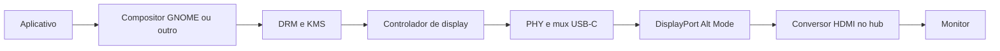

Uma tela preta tem várias causas possíveis: ausência física de saída de vídeo, porta errada do hub, cabo sem os sinais necessários, falha de negociação, monitor no input errado, driver incompleto ou sessão gráfica sem saída ativa. Reiniciar tudo pode recuperar a imagem e apagar justamente a evidência necessária para corrigir o problema.

**Dificuldade:** intermediária a avançada. **Pré-requisitos:** modelo e variante identificados, documentação de vídeo do fabricante ou port, terminal e acesso alternativo. **Materiais:** monitor, cabo comprovadamente funcional, hub compatível, alimentação adequada e uma tabela de testes. **Resultado:** descobrir a camada que falha e validar reconexão sem encerrar aplicações.

## Entenda o caminho de vídeo



Esse é um caminho típico de hub HDMI baseado em DP Alt Mode, não uma descrição de todos os adaptadores. **MHL** é outro padrão, encontrado em alguns aparelhos mais antigos e exige adaptador/implementação próprios. Adaptadores **DisplayLink** transportam display por USB com outra pilha de software; não substituem automaticamente DP Alt Mode no Linux ARM. Espelhamento pela rede ou [sessão remota](../desktop/acesso-remoto.md) também usa um caminho diferente.

O monitor informa modos através de EDID. A detecção de conexão produz eventos de hotplug, e o compositor escolhe um modo e programa o controlador por KMS. Um estado `connected` prova parte da detecção, não a presença de pixels visíveis.

## Preparação e backup

Salve trabalhos abertos. Não altere a imagem de boot para investigar um cabo. Reserve um terminal SSH e registre configuração gráfica antes de qualquer teste. Se estiver em Wayland, `xrandr` geralmente consulta Xwayland; ele não administra o monitor físico do Mutter.

## Teste por camadas

1. **Leia estado e modos dos conectores.**

   ```sh
   for connector in /sys/class/drm/card*-*; do
     [ -r "$connector/status" ] || continue
     printf '\n%s\n' "$connector"
     cat "$connector/status"
     [ -r "$connector/modes" ] && cat "$connector/modes"
     [ -r "$connector/edid" ] && wc -c "$connector/edid"
   done
   ```

   `disconnected` com zero bytes de EDID aponta para uma falha anterior à seleção de resolução, embora o driver também possa relatar estado incorretamente. `connected` com modos reconhecidos permite investigar KMS/compositor. Não copie o nome `DP-1` de outro aparelho: identifique seu conector.

2. **Observe a transição, sem reiniciar a sessão.**

   ```sh
   sudo udevadm monitor --kernel --udev --property --subsystem-match=drm
   ```

   Em outro terminal, use `sudo dmesg -w`. Se `udevadm` não existir, registre o kernel e os estados de sysfs antes/depois. Desconecte primeiro só HDMI e depois todo o hub, em testes separados. Compare eventos `change`, timeouts AUX/link training, EDID e enumeração USB.

3. **Confira compositor e acesso ao dispositivo.**

   ```sh
   ps -eo pid,ppid,user,args | rg 'gnome-shell|mutter|weston|Xorg|Xwayland'
   ls -l /dev/dri
   ```

   Um compositor ativo não prova modeset bem-sucedido. Em sistemas systemd, os registros do GNOME podem estar em `journalctl --user -b`; em OpenRC/ports próprios, veja o launcher e arquivos em `/var/log`. Procure falhas de DRM, formatos, planos e permissões sem alterar flags globais.

4. **Teste uma configuração conservadora pela interface.** Se o monitor é reconhecido e a tela está acessível, escolha um modo que ele anuncia, por exemplo 1280×720 a 60 Hz, e escala inteira. Use a confirmação automática/reversão do painel de Monitores. A resolução menor ajuda a separar largura de banda/formato de ausência completa de negociação. Não imponha modelines de outro equipamento.

5. **Compare orientação e cabos.** USB-C deveria funcionar nas duas orientações quando a implementação permite esse uso. Se apenas uma funciona, registre ambas: isso pode envolver cabo, contato, mux, PHY ou código de orientação. O teste não identifica sozinho qual elemento está defeituoso.

## O que uma correção persistente precisa demonstrar

Se o kernel não gera eventos adequados, modificar só a configuração do GNOME não corrige o evento ausente. Um port pode precisar de patch no driver/DT ou adaptação documentada. Se o compositor recebe eventos e morre, colete sua falha. Se um supervisor decide reiniciar o desktop quando fica sem monitor, corrija a política do supervisor, mantendo o processo da sessão vivo.

Não use `modetest` para programar a saída enquanto o compositor a controla. Consultas e testes KMS exigem conhecer o driver, a versão da ferramenta e quais opções são apenas leitura. Capturas por mmap de buffers DRM downstream também podem atingir código vendor inseguro; prefira captura oficial do compositor, quando disponível.

## Reversão e aceitação

Restaure a resolução anterior pelo painel e a configuração salva se algum teste a modificou. Patch de kernel só deve ser integrado após backup, mecanismo de boot anterior e revisão específica do modelo. Na impossibilidade de corrigir upstream, documente um workaround com suas condições, sem chamá-lo de hotplug resolvido.

Critério de aceitação: cinco ciclos HDMI, cinco ciclos de hub, um boot com hub e um sem hub; mesma sessão e documento aberto; teclado/mouse respondem; monitor recebe imagem real; nenhum panic. Esses números são um protocolo inicial proposto para este projeto, não um padrão de certificação. Veja [sessão portátil](../desktop/sessao-portatil.md) e o [estudo OnePlus](../dispositivos/oneplus-9-pro.md), que contém limitações conhecidas.

**Fontes e verificação:** **2026-10-10**; [DRM/KMS](https://docs.kernel.org/gpu/drm-kms.html), [drivers Type-C Alt Mode](https://docs.kernel.org/driver-api/usb/typec_bus.html), [classe Type-C](https://docs.kernel.org/driver-api/usb/typec.html). Os testes acima são um método de diagnóstico; não foram executados em todos os dispositivos.
