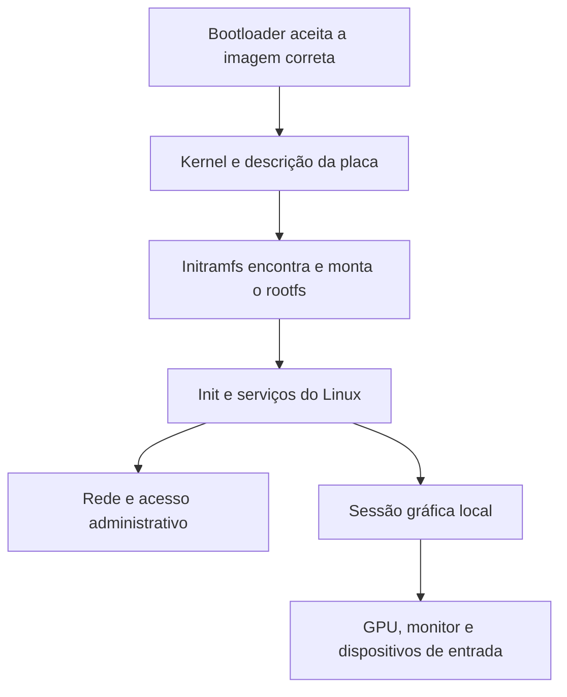

## Resultado esperado

Esta página prepara a escolha de uma instalação que substitua o ambiente Android principal. O resultado desejado é **telefone ligado → kernel e Linux inicializam → sessão ou serviços ficam disponíveis**, sem um computador externo iniciar o sistema a cada vez. Dificuldade: intermediária em port mantido, avançada/experimental em hardware sem adaptação pronta.

“Nativo” não exige que todos os drivers sejam mainline. Uma distribuição pode iniciar diretamente com um kernel downstream do fabricante e aproveitar uma camada de compatibilidade com componentes Android. Isso é diferente de executar uma distribuição por PRoot dentro de um aplicativo Android. Também é diferente de usar o telefone apenas como cliente de um desktop em outro computador.

## Peças que precisam funcionar juntas



O **rootfs** contém o sistema de arquivos da distribuição; o **initramfs** é um ambiente inicial pequeno que ajuda a encontrar o sistema definitivo. Uma imagem ARM64 genérica pode conter programas corretos para a CPU, mas não fornecer o kernel, device tree ou formato de boot da placa. Por isso a imagem de um Raspberry Pi não é uma instalação pronta para um smartphone ARM64.

## Requisitos e materiais

Você precisa de modelo/variante confirmados, bootloader elegível quando requerido, instrução de instalação vigente, firmware de base correto, pacote íntegro e [recuperação planejada](../preparacao/backup.md). O computador, cabo e modo USB devem seguir o projeto escolhido. Para desktop, liste monitor, adaptador, teclado, mouse e energia, mas instale com a montagem mínima documentada; hubs acrescentam variáveis ao flash.

Não exija root Android automaticamente. Muitos métodos nativos usam bootloader desbloqueado e Fastboot, sem root. Outros usam recovery ou uma ferramenta específica. Acrescentar Magisk ou recovery sem necessidade amplia o número de alterações e pode destruir a referência original.

## Escolha de distribuição

| Caminho | Indicado quando | Principal verificação |
|---|---|---|
| [postmarketOS/Nura com imagens](postmarketos-imagens.md) | Há imagem mantida e método para sua variante | Funcionalidades e destino da imagem |
| [postmarketOS via pmbootstrap](postmarketos-pmbootstrap.md) | Há pacote de dispositivo e você precisa gerar uma imagem | Configuração, branch, kernel e instruções de flash |
| [Ubuntu Touch](ubuntu-touch.md) | Seu modelo aparece no catálogo UBports | Variante, firmware Android e recursos de convergência |
| [Mobian](mobian-droidian.md) | Aparelho possui suporte mainline mantido pelo projeto | Página específica e nível de suporte |
| [Droidian](mobian-droidian.md) | Há adaptação compatível com vendor/Android do modelo | Kernel adaptado, API vendor e imagem específica |
| Sailfish OS | Modelo oficial ou port comunitário documentado | [Suporte, licenciamento e condições](https://docs.sailfishos.org/Support/Supported_Devices/) |
| [Desenvolver um port](porting.md) | Não há instalação pronta e você aceita trabalho de engenharia | Código, boot, recuperação e testes por componente |

Não troque a distribuição só porque faltou um pacote se o problema real é o kernel. Debian versus Alpine muda o userspace e o gerenciador de pacotes; não acrescenta automaticamente um driver de USB-C ausente. Escolha pela compatibilidade e manutenção antes da familiaridade com `apt`.

## Procedimento comum, sem fingir que o flash é universal

1. Complete [inventário](../compatibilidade/inventario.md) e [matriz de suporte](../compatibilidade/matriz.md).
2. Leia a página **da variante exata** e registre firmware, slot, recovery, método e restrições.
3. Faça backup externo e prepare o retorno ao original.
4. Instale ferramentas no computador e verifique detecção.
5. Obtenha uma imagem publicada ou gere com a receita correta.
6. Confira assinatura/hash, arquivos e alvo antes da gravação.
7. Execute apenas a sequência específica documentada, sem misturar instruções de outro modelo.
8. Inicialize sem periféricos extras; confirme acesso administrativo.
9. Acrescente rede, desktop, monitor e dispositivos um por vez.
10. Faça testes de reinício e reconexão antes de considerar o aparelho um computador confiável.

Cada tutorial abaixo explica como concluir essas etapas até o ponto em que precisa das condições específicas do port. Quando a fonte não estiver acessível ou faltar uma imagem validada, a etapa destrutiva fica explicitamente bloqueada. Isso evita preencher uma lacuna documental com comandos que poderiam inutilizar o aparelho.

## Verificação básica no Linux instalado

**Local: terminal do telefone, ou SSH autenticado.**

```bash
cat /etc/os-release
uname -a
ps -p 1 -o comm=
df -h
ip address
```

O primeiro comando identifica a distribuição; o segundo, o kernel. O processo de PID 1 indica o init, cuja implementação muda os comandos de serviços. `df` mostra o espaço montado, e `ip address` as interfaces; nomes variam. Ter GNOME instalado não prova que ele é a sessão do boot. Ter uma janela GNOME dentro de outro desktop não é a configuração principal pretendida.

Confira logs e a sessão antes de remover o desktop anterior. Remover metapacotes pode retirar dependências que o outro ambiente também utiliza; simule a operação pelo gerenciador de pacotes e preserve configurações. O caminho correto para GNOME depende de display manager, seat, permissões, DRM e renderer efetivamente disponíveis.

## Backup, riscos, erros e rollback

Os riscos incluem apagamento de dados, falha de boot, funções indisponíveis e necessidade de restauração específica. Não apague partições de firmware ou calibração como “limpeza”. `super`, `userdata`, `boot` e `dtbo` têm funções diferentes; comandos de outro port não são exemplos inofensivos.

Se o boot funcionar mas faltar vídeo, confirme acesso por rede antes de reinstalar. Se não houver kernel compatível, mantenha Android ou participe do porting. Se o novo sistema falhar, use o plano específico preparado; o [guia de triagem](../recuperacao/triagem.md) ajuda a identificar o modo antes de gravar qualquer imagem.

## Testes finais

Faça um boot sem computador, teste rede e entrada, reinicie, reconecte o hub/HDMI, confira carga e monitore temperatura durante o uso previsto. Registre limitações de forma concreta. Não certifique como resolvido um problema intermitente após apenas uma reconexão bem-sucedida.

## Fontes e limites da verificação

Verificação documental em **10/10/2026**; os procedimentos de flash são dependentes do modelo e não foram repetidos em todos os aparelhos.

- [Nura: instalação e categorias de imagens](https://nura.eco/install/).
- [UBports: instalação em modelos suportados](https://docs.ubports.com/en/latest/userguide/install.html).
- [Mobian: dispositivos](https://wiki.debian.org/Mobian/Devices).
- [Droidian: porting e kernel adaptado](https://docs.droidian.org/porting-guide/).
- [AOSP: partição de boot](https://source.android.com/docs/core/architecture/partitions/generic-boot).
